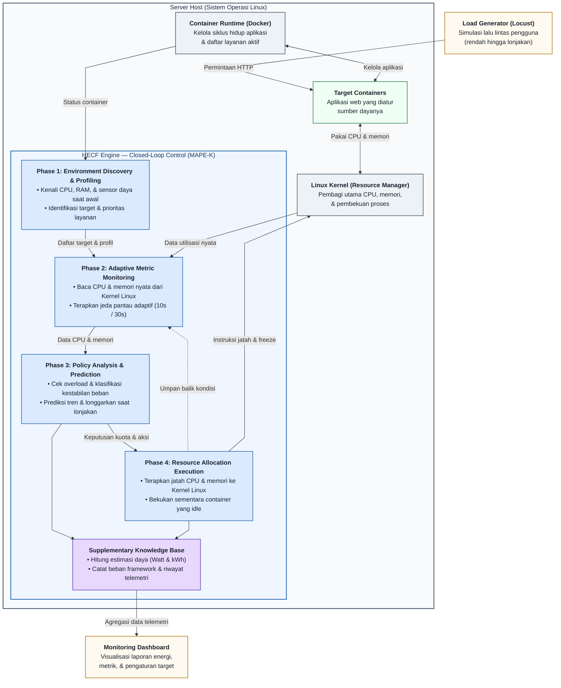
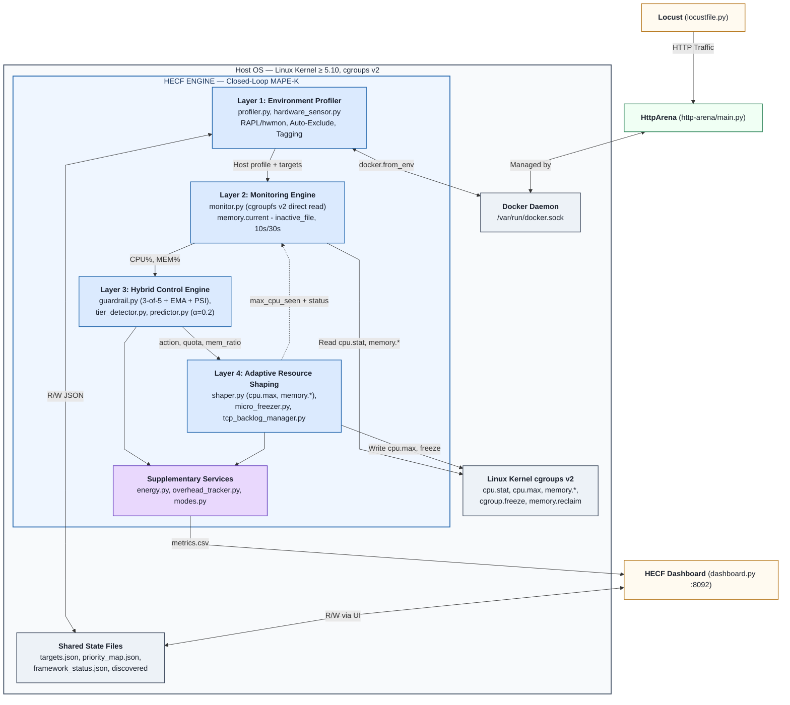

# Gambaran Besar Arsitektur HECF (MAPE-K Closed-Loop Control)

> **Kategori:** Inovasi Algoritma (S2)
> **Sumber kode:** `framework/main.py` (orkestrasi siklus kontrol utama yang menyatukan seluruh lapisan)

Dalam infrastruktur komputasi modern berbasis *container*, puluhan layanan sering kali berjalan berdampingan di atas satu server fisik yang sama. Secara bawaan, pembagian tenaga prosesor (CPU) dan memori antarlayanan cenderung bersifat pasif: batas sumber daya biasanya ditetapkan secara statis atau bahkan dibiarkan terbuka tanpa kendali adaptif. Pola seperti ini menimbulkan dilema yang sulit dihindari. Ketika batas dibuat terlalu longgar, aplikasi yang sedang sepi pengunjung tetap mempertahankan cadangan memori dan memicu konsumsi daya yang tidak perlu, sementara aplikasi yang mengalami lonjakan trafik dapat menghabiskan sumber daya server dan mengganggu layanan lain. Sebaliknya, pembatasan statis yang terlalu ketat justru mencekik performa aplikasi saat pengunjung sedang ramai.

**HECF (Hybrid Energy-Aware Container Framework)** hadir untuk memecahkan dilema tersebut melalui pendekatan **siklus kontrol tertutup** (*closed-loop control*) berbasis pola arsitektur **MAPE-K** (*Monitor, Analyze, Plan, Execute, Knowledge*). Alih-alih menetapkan aturan satu kali untuk selamanya, HECF bertindak sebagai pengatur otomatis di dalam server yang terus-menerus mengamati pemakaian aktual sumber daya, mempelajari karakteristik beban setiap aplikasi, merencanakan penyesuaian kuota secara cerdas, lalu menerapkannya melalui Kernel Linux. Hasil dari setiap penyesuaian tersebut kemudian diamati kembali pada putaran berikutnya sehingga sistem mampu menyeimbangkan efisiensi energi listrik dan keandalan layanan secara berkesinambungan.

---

## 1. Alur Logika Konseptual (Gambaran Besar Sistem)

Diagram berikut memperlihatkan posisi HECF di dalam server Linux, bagaimana keempat fase kontrolnya saling terhubung dengan Kernel Linux dan sistem container, serta bagaimana proses pengujian beban dan pemantauan laporan bekerja dari luar engine.

*Gambar 1. Arsitektur konseptual HECF sebagai sistem kontrol tertutup di atas server Linux.*

---

## 2. Penjelasan Analitis Alur MAPE-K

Jika dibaca secara menyeluruh, gambar di atas memisahkan dunia luar (pengguna maupun pengelola sistem) dengan mekanisme pengaturan internal di dalam server Linux. Permintaan dari **Load Generator** masuk ke **Target Containers** yang berjalan di atas **Docker**. Seluruh proses komputasi aplikasi tersebut pada dasarnya dieksekusi oleh **Kernel Linux**, karena kernel merupakan satu-satunya lapisan yang memiliki kendali mutlak atas penjadwalan prosesor dan pembagian memori fisik. HECF tidak menggantikan peran kernel tersebut; sebaliknya, HECF berperan sebagai lapisan pengambil keputusan yang membaca keadaan nyata dari kernel lalu memberikan instruksi alokasi yang jauh lebih cerdas dibandingkan pengaturan statis bawaan.

Di dalam jantung HECF Engine, empat fase bekerja secara berurutan dan berulang:

**Phase 1: Environment Discovery & Profiling (Monitor Awal).** Ketika pertama kali dijalankan, HECF memetakan kemampuan perangkat keras host—berapa banyak inti CPU yang tersedia, seberapa besar kapasitas memori total, dan apakah prosesor menyediakan sensor pembacaan daya listrik fisik. Informasi ini mencegah sistem membuat keputusan yang tidak realistis terhadap kemampuan mesin. Setelah itu, pada setiap siklus ia menemukan layanan container aktif dan menerapkan pemetaan prioritas. Layanan yang sangat sensitif terhadap gangguan (seperti basis data atau jalur jaringan) otomatis dilindungi dari pembatasan keras, sementara aplikasi web biasa dapat diatur secara agresif maupun dibekukan saat menganggur.

**Phase 2: Adaptive Metric Monitoring (Monitor Berkelanjutan).** HECF mengumpulkan data penggunaan CPU dan memori efektif tiap aplikasi langsung melalui antarmuka sistem operasi. Tidak seperti pemantau biasa yang berjalan dengan frekuensi tetap, fase ini menerapkan jeda pantau adaptif: ketika server berada dalam kondisi sibuk atau darurat, pembacaan dilakukan lebih rapat (10 detik) agar respons mitigasi berlangsung cepat; namun ketika keadaan tenang, jarak antarpengambilan data diperpanjang (30 detik) supaya framework pengawas ini tidak memboroskan daya CPU untuk dirinya sendiri.

**Phase 3: Policy Analysis & Prediction (Analyze & Plan).** Data pemakaian sesaat tidak langsung dipakai untuk menghukum aplikasi. Fase ini menganalisis tiga hal secara terpadu: kestabilan beban historis untuk membedakan aplikasi yang tenang dengan yang fluktuatif, proyeksi arah tren beban ke depan agar kenaikan beban dapat diantisipasi lebih dini, serta evaluasi kondisi darurat berdasarkan konsistensi beban tinggi. Dari perpaduan tersebut lahir keputusan kebijakan yang seimbang—melindungi server saat beban berlebih berkepanjangan (*Guardrail*), melonggarkan jatah terlebih dahulu saat terjadi lonjakan mendadak (*Pre-emptive Scale-Up*), atau mengatur pembatasan bertingkat sesuai karakter beban normalnya.

**Phase 4: Resource Allocation Execution (Execute) & Knowledge Base.** Keputusan dari fase analisis diterjemahkan ke Kernel Linux dalam bentuk perubahan batas CPU dan memori. Khusus untuk layanan non-prioritas yang terbukti menganggur tanpa permintaan masuk, HECF mengambil langkah penghematan lebih jauh melalui pembekuan sementara (*Micro-Freeze*) sambil memulihkan cadangan memori yang menganggur, sehingga daya komputasinya turun mendekati nol tanpa perlu mematikan aplikasi. Bersamaan dengan itu, **Supplementary Knowledge Base** mencatat estimasi daya (Watt dan kWh), overhead internal framework, dan riwayat metrik ke dalam basis data laporan yang diteruskan ke Dashboard sekaligus menjadi umpan balik bagi putaran kontrol berikutnya.

| Fase MAPE-K | Lapisan Arsitektur | Peran Utama dalam Siklus Kontrol |
| --- | --- | --- |
| **Monitor** | Phase 1 & Phase 2 | Mengenali kapasitas perangkat keras saat awal aktif, mendata container target beserta prioritasnya, lalu membaca pemakaian CPU dan memori aktual dengan interval adaptif. |
| **Analyze** | Phase 3 (Tier & Predictor) | Mengukur tingkat volatilitas beban historis dan memperkirakan arah perubahan tren pemakaian CPU dalam waktu dekat. |
| **Plan** | Phase 3 (Guardrail & Mode) | Mengevaluasi kondisi beban darurat, mendeteksi lonjakan mendadak, dan menetapkan aksi serta batas kuota CPU/memori untuk tiap aplikasi. |
| **Execute** | Phase 4 (Shaper & Freezer) | Menuliskan batasan kuota ke Kernel Linux atau membekukan sementara container non-prioritas yang menganggur beserta pemulihan memorinya. |
| **Knowledge** | Supplementary & Shared State | Menghitung konsumsi daya dan energi, memantau overhead internal HECF, menyimpan riwayat window/tren, serta merekam laporan untuk Dashboard dan evaluasi eksperimen. |

---

## 3. Detail Teknis & Pemetaan ke File Kode (`framework/`)

Bagian ini memetakan konsep arsitektur di atas secara langsung ke modul-modul Python di dalam direktori `framework/`.

### Pemetaan Blok ke File Kode (`framework/`)

1. **Orkestrator Utama (`framework/main.py`)**: Berisi loop utama `main()` beserta loop per-container yang mengeksekusi Layer 1–4 secara berurutan. File ini juga menampung logika pemilihan mode (`default_docker`, `static_cap`, `reactive_only`, `full_hecf`) yang menerjemahkan keluaran Layer 3 menjadi `action`, `quota`, dan `mem_ratio`.
2. **Layer 1 — Environment Profiler (`framework/profiler.py`, `framework/hardware_sensor.py`)**: `profile_host()` membaca `/proc/cpuinfo` dan `/proc/meminfo`, menghitung `P_idle`/`P_max`, memeriksa `/proc` dan `nf_conntrack_max`, serta mendeteksi sensor energi `PowerSensor` (Intel RAPL `energy_uj` atau AMD `hwmon` `energy1_input`). `discover_containers()` mendata container lewat Docker API, menerapkan auto-exclude (port kritis seperti DB/SSH/VPN serta daftar `EXCLUDED_CONTAINERS`), auto-priority (port HTTP/HTTPS/DNS/NTP dan pola nama infrastruktur jaringan), membaca `targets.json` + `priority_map.json`, dan menulis `discovered_containers.json`.
3. **Layer 2 — Monitoring Engine (`framework/monitor.py`)**: Membaca langsung berkas virtual cgroups v2 (`cpu.stat`, `memory.current`, `memory.stat`, `memory.max`) untuk menghitung persentase CPU dan memori kerja (`memory.current - inactive_file`), lengkap dengan 1× retry dan penanda *stale*. Juga menyediakan `get_adaptive_interval()` (CPU ≥ 60% → 10 s, lainnya → 30 s).
4. **Layer 3 — Hybrid Control Engine**:
   - `framework/tier_detector.py` (3B): Memakai satu sliding window hingga 120 sampel untuk menghitung `spike_ratio = P95 / P50`, mengelompokkan Tier 1 (`> 2.0`), Tier 2 (`1.5–2.0`), dan Tier 3 (`< 1.5`) dengan hysteresis simetris 3 sampel berturut-turut, serta fallback Tier 2 selama sampel `< 10`.
   - `framework/predictor.py` (3C): Menghitung prediksi tren beban menggunakan Exponential Moving Average (EMA) dengan bobot tetap `α = 0.2` dan turunan kecepatannya `d(EMA)/dt`.
   - `framework/guardrail.py` (3A): Menandai sampel sebagai overload bila CPU > 80%, RAM > 90%, atau (khusus `full_hecf`) turunan `d(EMA)/dt > 5.0` saat `EMA > 50%`. Bila `EMA ≥ 75%`, ambang CPU efektif diturunkan ke 75% (*pre-warning*). Guardrail aktif ketika minimal 3 dari 5 sampel terakhir berstatus overload; sinyal PSI dibaca sebagai log konfirmasi.
5. **Layer 4 — Adaptive Resource Shaping (`framework/shaper.py`, `framework/security/micro_freezer.py`, `framework/security/tcp_backlog_manager.py`)**: Menuliskan `cpu.max` (dengan lantai pengaman 0,2 core dan validasi *read-back*) serta—khusus container non-priority di bawah `GUARDRAIL` atau `AGGRESSIVE`—mengatur `memory.max`, `memory.high` (`0.85×`), dan `memory.swap.max`. Bila container non-priority menganggur ≥ 0,8 detik (`cgroup.events populated = 0` atau fallback polling) tanpa koneksi terbuka, `MicroFreezer` menulis `cgroup.freeze = 1` (maksimum 1000 ms per siklus) dan `main.py` memanggil `reclaim_memory()`.
6. **Supplementary (`framework/energy.py`, `framework/overhead_tracker.py`, `framework/modes.py`)**: Menghitung daya aditif CPU + DRAM (berbasis sensor fisik atau model linier Jarus et al. + 0,38 W/GB DRAM dari Kansal et al.), mengukur overhead CPU/RAM container HECF sendiri, dan memvalidasi mode operasi eksperimen.

*Alur rinci siklus patroli dapat dilihat pada `main_control_loop.md`, sedangkan ekosistem infrastrukturnya dijelaskan pada `tools_infrastructure.md`.*

---

## 4. Glosarium

* **MAPE-K (*Monitor, Analyze, Plan, Execute, Knowledge*)**: Model arsitektur sistem otonom yang terus mengamati kondisi, menganalisis situasi, merencanakan tindakan, mengeksekusinya, dan memelihara basis pengetahuan untuk perbaikan putaran berikutnya.
* **Container**: Ruang isolasi ringan bagi sebuah aplikasi beserta pustaka pendukungnya agar dapat berjalan berdampingan di satu server fisik tanpa saling bertabrakan.
* **Kernel Linux**: Bagian inti sistem operasi yang menjembatani perangkat lunak dengan perangkat keras fisik (CPU dan memori) serta mengeksekusi batasan sumber daya.
* **Micro-Freezing**: Teknik menjeda sementara proses container yang menganggur agar tidak menyedot siklus CPU dan memulihkan memori yang tidak terpakai, tanpa mematikan aplikasi tersebut.
* *(Teknis)* **cgroups v2**: Subsistem Kernel Linux modern yang menyediakan antarmuka file virtual untuk mengukur pemakaian dan membatasi kuota CPU (`cpu.max`), memori (`memory.*`), serta pembekuan proses (`cgroup.freeze`).
* *(Teknis)* **PSI (*Pressure Stall Information*)**: Metrik bawaan Kernel Linux yang menunjukkan seberapa lama proses harus mengantre akibat keterbatasan sumber daya.
* *(Teknis)* **P95 / P50 (*Percentile*)**: Statistik distribusi beban; P50 merepresentasikan beban median normal, sedangkan P95 mencerminkan beban puncak saat terjadi lonjakan.
* *(Teknis)* **EMA (*Exponential Moving Average*)**: Teknik peramalan tren yang memberi bobot eksponensial lebih tinggi pada pengukuran terbaru agar responsif terhadap perubahan beban.
* *(Teknis)* **RAPL / hwmon**: Antarmuka sensor energi bawaan prosesor Intel (`/sys/class/powercap/intel-rapl`) dan AMD (`/sys/class/hwmon`) yang memberikan pembacaan konsumsi energi nyata dalam Joule untuk dikonversi ke Watt.
