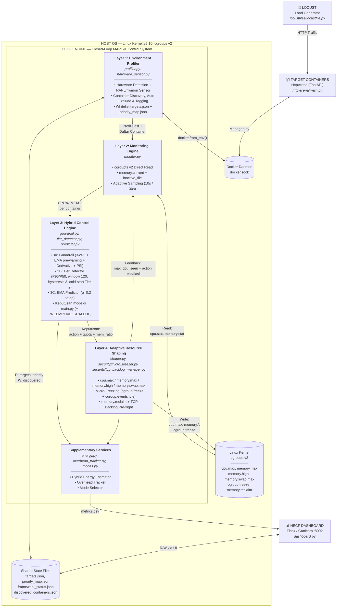
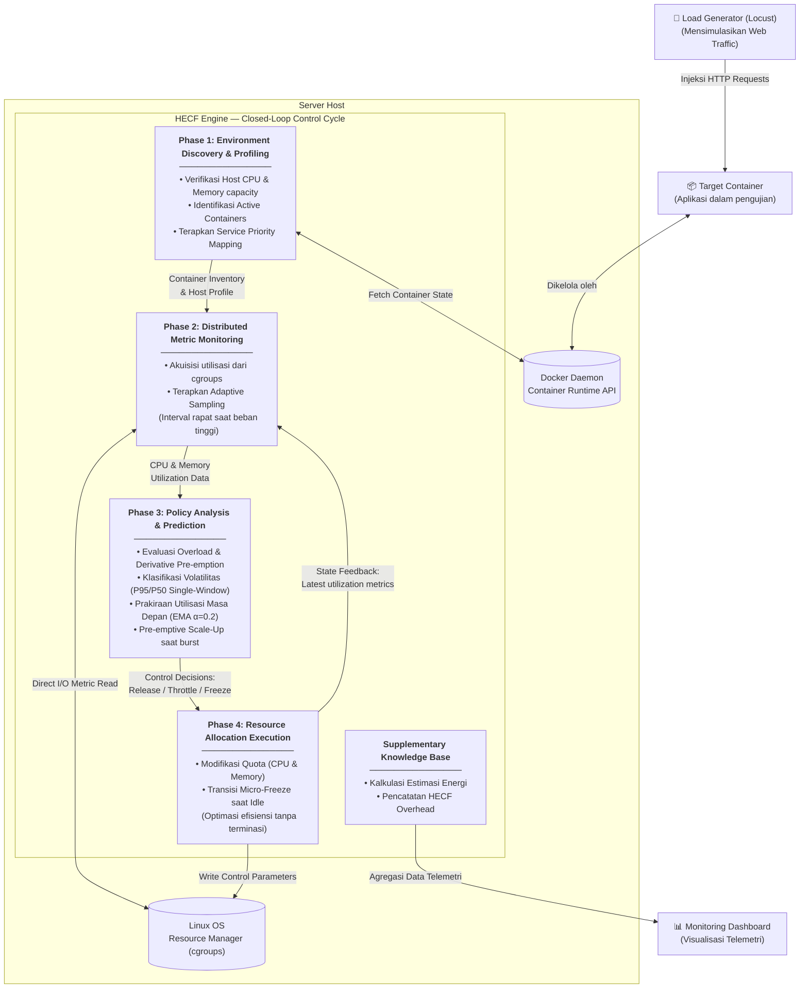

# Diagram Konsep Besar — HECF MAPE-K Closed-Loop Control

> **Kategori:** Inovasi Algoritma (S2)
> **Sumber:** `framework/main.py` (kontrol loop utama yang menyatukan semua layer, fungsi `main()` baris 191–503)

Diagram ini menunjukkan bagaimana HECF beroperasi sebagai **sistem kontrol tertutup (Closed-Loop / MAPE-K)**: Monitor → Analyze → Plan → Execute → Kembali ke Monitor.

## Penjelasan Alur MAPE-K

| Fase MAPE-K | Layer | Fungsi |
| --- | --- | --- |
| **Monitor** | Layer 1 + Layer 2 | Deteksi hardware, discover container, baca metrik CPU/MEM dari cgroupfs |
| **Analyze** | Layer 3B + 3C | Klasifikasi volatilitas (P95/P50), prediksi tren (EMA + d(EMA)/dt) |
| **Plan** | Layer 3A + logika mode `main.py` | Guardrail 3-of-5, lalu pemilihan `action`/`quota` (GUARDRAIL, PREEMPTIVE_SCALEUP, AGGRESSIVE, BALANCED, SOFT) |
| **Execute** | Layer 4 | Tulis parameter cgroups (cpu.max, memory.max/high/swap.max, cgroup.freeze, memory.reclaim) |
| **Knowledge** | Supplementary + shared state | Estimasi energi, overhead tracking, mode selector, sliding window/EMA state, `metrics.csv` |

---

## Alur Logika Konseptual

---

## 🗂️ Pemetaan Konsep ke File Kode (Daftar Isi Algoritma)

File ini berfungsi sebagai **Master Daftar Isi**. Berikut adalah penjelasan bagaimana setiap blok konseptual di atas diwujudkan dalam file *codingan* (Python) yang ada di dalam folder `framework/`:

### 1. File Utama (Orkestrator)
*   **`framework/main.py`**
    *   **Peran:** Jantung dari sistem HECF. File ini berisi loop utama `main()` (baris 191–503) dengan loop per-container (baris 271–478) yang terus menerus mengeksekusi siklus MAPE-K untuk setiap kontainer.
    *   **Interaksi:** Memanggil fungsi-fungsi dari Layer 1, 2, 3, dan 4 secara berurutan, serta berisi **logika keputusan mode** (baris 357–410) yang menerjemahkan output Layer 3 menjadi `action`, `quota`, dan `mem_ratio`.

### 2. Layer 1: Environment Profiler (Monitor - Awal)
*   **`framework/profiler.py`**: `profile_host()` membaca `/proc/cpuinfo` dan `/proc/meminfo`, menghitung `P_idle`/`P_max`, memverifikasi mount `/proc` host, dan mengecek `nf_conntrack_max`. `discover_containers()` mencari kontainer via Docker API, menerapkan auto-exclude (port kritis/daftar EXCLUDED), auto-priority (port HTTP/DNS dan pola nama infra jaringan), membaca `priority_map.json` + `targets.json`, serta menulis `discovered_containers.json`.
*   **`framework/hardware_sensor.py`**: Class `PowerSensor` yang mendeteksi Intel RAPL (`energy_uj`) atau AMD/hwmon (`energy1_input`) dan mengonversi ΔJoule/Δt menjadi Watt.

### 3. Layer 2: Monitoring Engine (Monitor - Lanjutan)
*   **`framework/monitor.py`**: Membaca langsung _virtual file_ cgroups (`cpu.stat`, `memory.current`, `memory.stat`, `memory.max`) untuk mendapatkan % CPU dan % memori efektif tiap kontainer (dengan 1× retry dan penanda *stale*). Juga menyediakan `get_adaptive_interval()` (≥ 60% → 10s, selain itu 30s).

### 4. Layer 3: Hybrid Control Engine (Analyze & Plan)
Layer ini adalah otak kecerdasan (S2) dari HECF yang terdiri dari 3 algoritma yang saling bekerjasama:
*   **`framework/tier_detector.py` (3B)**: Menganalisa data dari Layer 2 dengan satu sliding window 120 sampel, menghitung `spike_ratio = P95/P50`, lalu menentukan Tier 1 (spiky), Tier 2, atau Tier 3 (tenang) dengan hysteresis simetris 3 sampel. Selama < 10 sampel, selalu mengembalikan Tier 2 (cold-start fallback).
*   **`framework/predictor.py` (3C)**: Menggunakan EMA dengan alpha tetap 0.2 untuk memprediksi CPU dan menghitung kecepatan tren naiknya (`d(EMA)/dt`).
*   **`framework/guardrail.py` (3A)**: Menerima CPU, RAM, serta EMA dan turunannya dari `predictor.py` (hanya di mode `full_hecf`). EMA ≥ 75% menurunkan threshold CPU dari 80% ke 75%; turunan > 5.0 dengan EMA > 50% dihitung sebagai sampel overload. Guardrail aktif jika ≥ 3 dari 5 sampel terakhir overload. Sinyal PSI hanya dicatat sebagai konfirmasi.

### 5. Layer 4: Adaptive Resource Shaping (Execute)
*   **`framework/shaper.py`**: Menerima `quota` dan `mem_ratio` dari `main.py`, lalu menulis `cpu.max` (dengan floor 0.2 core dan validasi read-back) serta — khusus non-priority di bawah GUARDRAIL/AGGRESSIVE — `memory.max`, `memory.high` (0.85×), dan `memory.swap.max` (berbasis zram). Juga menyediakan `reclaim_memory()` untuk `memory.reclaim`.
*   **`framework/security/micro_freezer.py`**: Mengevaluasi kontainer non-priority; bila idle ≥ 0.8s (berdasarkan timestamp aktivitas terakhir + `cgroup.events populated`) dan tidak ada koneksi terbuka (eBPF/proc), menulis `cgroup.freeze = 1`. `main.py` lalu memanggil `reclaim_memory()`.
*   **`framework/security/tcp_backlog_manager.py`**: Pre-flight cold-start yang memastikan `somaxconn` cukup menampung antrean selama freeze.

### 6. Supplementary (Knowledge / Pendukung)
*   **`framework/energy.py`**: Estimasi daya (Watt) dan energi (kWh) per kontainer — mode hardware (apportionment) atau software (model linear Jarus et al.).
*   **`framework/overhead_tracker.py`**: Mengukur CPU dan RAM container HECF sendiri dari cgroup-nya.
*   **`framework/modes.py`**: Menyimpan pilihan mode eksperimen (`default_docker`, `static_cap`, `reactive_only`, `full_hecf`).

*Untuk melihat alur loop yang menyambungkan semua file ini, silakan lanjut ke file `main_control_loop.md`.*

---

## 📖 Glosarium (Keterangan Istilah Teknis)

Untuk mempermudah pemahaman arsitektur, berikut adalah penjelasan singkat mengenai istilah-istilah teknis yang digunakan:

*   **MAPE-K (Monitor, Analyze, Plan, Execute, Knowledge)**: Model arsitektur sistem otonom yang secara terus-menerus memantau kondisi, menganalisis data, merencanakan tindakan, dan mengeksekusi penyesuaian secara terotomatisasi.
*   **cgroups v2**: Fitur manajemen sumber daya pada kernel Linux yang berfungsi untuk mengukur dan membatasi alokasi komputasi (seperti CPU dan Memori) untuk setiap *container*.
*   **PSI (Pressure Stall Information)**: Metrik bawaan kernel Linux yang memberikan indikasi langsung mengenai tingkat saturasi atau kepadatan antrean pemrosesan sistem.
*   **P95 / P50 (Percentile)**: Metrik statistik distribusi beban. P50 (Median) merepresentasikan beban normal, sedangkan P95 mengindikasikan lonjakan beban ekstrem (*spiky workload*).
*   **EMA (Exponential Moving Average)**: Algoritma peramalan (*forecasting*) yang memberikan bobot lebih besar pada data terbaru untuk memprediksi tren pemakaian sumber daya secara *real-time*.
*   **RAPL (Running Average Power Limit)**: Antarmuka sensor energi prosesor Intel (`/sys/class/powercap/intel-rapl`). Pada AMD, padanannya dibaca dari `hwmon` (`energy1_input`). Keduanya memberi penghitung energi (Joule) yang dikonversi menjadi Watt.
