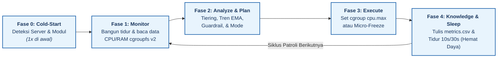
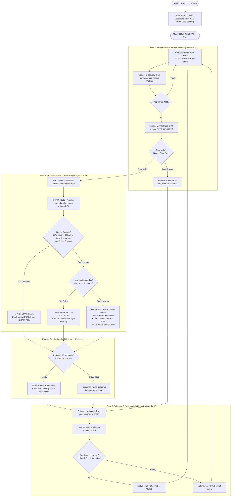
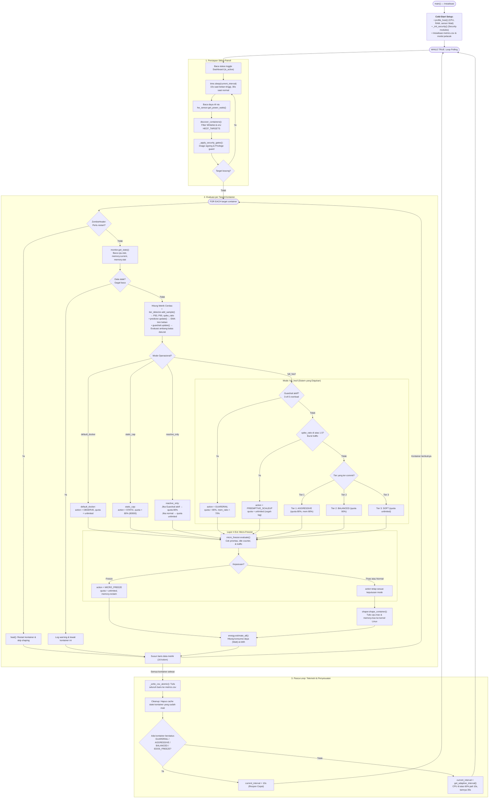

# Flowchart — Main Control Loop (MAPE-K Per-Container Decision)

> **Kode Sumber:** `framework/main.py` → fungsi `main()` (baris 191–503), khususnya loop per-container (baris 271–478), logika keputusan mode (baris 357–410), Micro-Freezing (baris 412–432), dan post-loop (baris 480–503)  
> **Posisi di Diagram:** Ini adalah **alur keseluruhan** yang menyatukan Layer 1–4 + Supplementary  
> **Kategori:** 🌟 INOVASI ALGORITMA (S2) — Closed-Loop MAPE-K Orchestration  

Dokumen ini menjelaskan alur kerja loop kontrol tertutup (*closed-loop control*) HECF. Agar mudah dipahami, dokumen disusun dari **gambaran umum 4 fase**, **diagram konseptual modular**, **diagram teknis detail**, hingga **panduan narasi langkah demi langkah** dan **kamus istilah**.

---

## 🧭 1. Gambaran Umum (Bird's-Eye View: Siklus 4 Fase)

HECF bekerja secara periodik seperti "satpam patroli cerdas" berbasis model **MAPE-K** (*Monitor - Analyze - Plan - Execute - Knowledge*):

---

## 🧩 2. Alur Logika Konseptual (Tersusun per Fase)

Diagram konseptual berikut membagi alur keputusan per kontainer ke dalam kelompok fase yang logis dan bersih:

---

## 🛠️ 3. Diagram Teknis Kode Aktual (`framework/main.py`)

Diagram ini memetakan kode aktual dengan seluruh percabangan mode operasional (`default_docker`, `static_cap`, `reactive_only`, dan `full_hecf`), ekstensi keamanan, serta modul *micro-freezer*:

> **Catatan Teknis Penting:**
> 1. **`PREEMPTIVE_SCALEUP`**: Pada mode `full_hecf`, saat tidak ada status Guardrail, sistem mengecek `spike_ratio > 1.5` terlebih dahulu. Jika terdeteksi lonjakan mendadak, kuota CPU langsung dilepas (*unlimited*) agar lonjakan request diserap dengan cepat tanpa lag.
> 2. **Evaluasi Micro-Freezing**: Dijalankan setelah keputusan alokasi resource dibuat (pada seluruh mode yang mengaktifkan micro-freezer). Jika kontainer idle, pembekuan mengesampingkan pembatasan kuota normal.
> 3. **Interval Cepat Dipaksa (10s)**: Interval dipercepat ke 10 detik apabila ada kontainer dalam status `GUARDRAIL`, `AGGRESSIVE`, `BALANCED`, atau `EDOS_FREEZE` agar proses mitigasi maupun de-eskalasi berlangsung responsif.

---

## 🎙️ 4. Panduan Menjelaskan Alur Langkah demi Langkah

Jika Anda perlu mempresentasikan diagram ini, ikuti alur narasi berikut:

| No | Tahap | Apa yang Terjadi? | Mengapa Dilakukan? (Tujuan) |
| :---: | :--- | :--- | :--- |
| **0** | **Cold-Start Setup** | Sistem mendeteksi spesifikasi server (jumlah CPU, RAM total, sensor daya listrik). | Agar batasan kuota dihitung proporsional terhadap kapasitas asli server fisik. |
| **1** | **Adaptive Sleep** | Framework tidur sejenak (**30 detik** saat tenang, atau **10 detik** saat sibuk). | **Hemat daya host.** Menghindari loop CPU 100% dan menjaga overhead HECF tetap $<5\%$. |
| **2** | **Discovery & Validation** | Mencari kontainer target via Docker API dan membaca file status kernel (`cgroupfs v2`). Jika data tidak terbaca (**stale**), kontainer dilewati. | Mencegah crash jika kontainer baru saja dimatikan atau sistem sedang sibuk membaca virtual file. |
| **3** | **Analisis Cerdas (Layer 3)** | Menghitung kestabilan beban (**Tier Detector**), memprediksi tren masa depan (**EMA**), dan mengecek kondisi bahaya (**Guardrail**). | Menghasilkan keputusan berbasis data riil dan prediksi, bukan sekadar aturan statis. |
| **4** | **Pengambilan Keputusan** | <ul><li>**Overload Bahaya?** $\to$ Aktifkan Guardrail (cekik CPU).</li><li>**Lonjakan Mendadak?** $\to$ Pre-emptive Scale-up (lepas batas).</li><li>**Normal?** $\to$ Ikuti Tier (Tier 1: ketat, Tier 2: sedang, Tier 3: bebas).</li></ul> | Menyeimbangkan penghematan energi dengan jaminan SLA performa aplikasi. |
| **5** | **Micro-Freeze & Cgroup Write** | Jika aplikasi menganggur (idle), bekukan prosesnya. Jika aktif, tulis nilai kuota ke kernel Linux (`cpu.max`). | Mengurangi daya kontainer idle hingga mendekati 0 Watt tanpa mematikan aplikasi. |
| **6** | **Pencatatan & Penyesuaian** | Hitung konsumsi daya (Watt & kWh), tulis ke `metrics.csv`, dan tentukan interval tidur putaran berikutnya. | Menyediakan data eksperimen yang lengkap dan akurat secara *atomic*. |

---

## 📖 5. Kamus Istilah Teknis (Glosarium)

* **MAPE-K (*Monitor, Analyze, Plan, Execute, Knowledge*)**: Pola arsitektur standar komputasi otonom di mana sistem mengamati dirinya sendiri dan melakukan adaptasi secara otomatis tanpa intervensi manual.
* **Adaptive Sleep Interval (10s / 30s)**: Mekanisme tidur berkala yang fleksibel: 30 detik saat beban rendah demi meminimalkan penggunaan daya oleh framework sendiri, atau 10 detik saat beban tinggi/darurat agar respon mitigasi cepat.
* **Stale Data**: Data pembacaan cgroupfs v2 yang usang, kosong, atau gagal diambil (misalnya karena kontainer baru saja berhenti atau terhapus). Sistem menandainya agar tidak salah menjatah CPU.
* **Cold-Start**: Tahap awal ketika HECF pertama kali dihidupkan untuk mengenali profil perangkat keras dan mengumpulkan sampel awal sebelum menerapkan kebijakan agresif.
* **Guardrail (3-of-5 samples)**: Rem darurat. Jika penggunaan CPU $>80\%$ atau RAM $>90\%$ terjadi pada minimal 3 dari 5 sampel pemantauan terakhir, sistem langsung melakukan throttling ketat demi menyelamatkan stabilitas host.
* **EMA (*Exponential Moving Average*)**: Algoritma statistik berbobot eksponensial ($\alpha = 0.2$) yang memproyeksikan arah kenaikan atau penurunan beban CPU di masa depan.
* **Pre-emptive Scale-Up**: Pelepasan batas kuota CPU (*unlimited*) saat terdeteksi lonjakan lalu lintas yang curam (`spike_ratio > 1.5`) agar antrean request tidak tertahan (*lag*) dan latensi p95 tetap aman.
* **Micro-Freezing & Thaw**: 
  - *Freeze:* Membekukan proses kontainer menggunakan *cgroup freezer* saat tidak ada request, membebaskan cache memori, dan menurunkan konsumsi daya ke level terendah.
  - *Thaw:* Mencairkan dan mengaktifkan kembali kontainer begitu ada aktivitas komputasi atau traffic baru.
* **Cgroups v2 (*Control Groups*)**: Fitur kernel Linux modern yang digunakan HECF untuk membatasi dan mengisolasi resource CPU (`cpu.max`) dan memori (`memory.max`) secara langsung di level sistem operasi.
* **Hysteresis**: Mekanisme penundaan perpindahan status (memerlukan 3 sampel berturut-turut) untuk mencegah perubahan status yang terlalu sering atau tidak stabil akibat fluktuasi sesaat.
