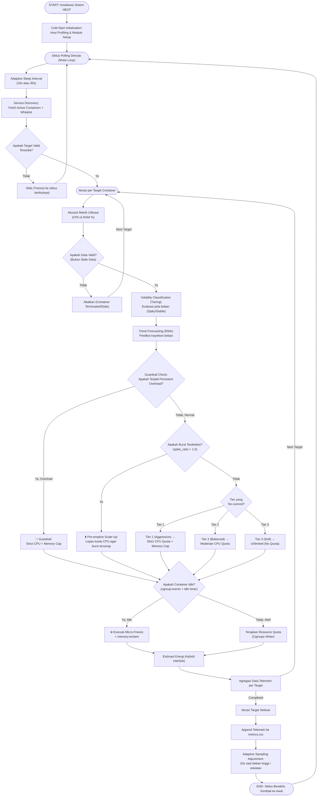

# Flowchart — Main Control Loop (MAPE-K Per-Container Decision)

> **Kode Sumber:** `framework/main.py` → fungsi `main()` (baris 191–503), khususnya loop per-container (baris 271–478), logika keputusan mode (baris 357–410), Micro-Freezing (baris 412–432), dan post-loop (baris 480–503)
> **Posisi di Diagram:** Ini adalah **alur keseluruhan** yang menyatukan Layer 1–4 + Supplementary
> **Kategori:** 🌟 INOVASI ALGORITMA (S2) — Closed-Loop MAPE-K Orchestration

Flowchart ini menunjukkan bagaimana semua algoritma terintegrasi dalam satu **siklus kontrol tertutup** per polling cycle. Inilah "otak utama" HECF.

```mermaid
flowchart TD
    START(["main() — HECF Control Loop Start"])

    INIT["<b>Cold-Start Initialization</b><br/>• profile_host() → cpu_count, mem_total_mb, P_idle, P_max, hw_sensor<br/>• _init_security() → modul security + MicroFreezer + TCPBacklogManager.verify()<br/>• Inisialisasi metrics.csv (header 16 kolom)<br/>• Monitor, Guardrail, TierDetector, EMAPredictor, OverheadTracker<br/>• current_interval = 30s"]

    LOOP_START(["WHILE TRUE — Polling Cycle"])

    CHECK_ACTIVE["Baca framework_status.json<br/>is_active = True/False<br/>(toggle dari Dashboard)"]
    SLEEP["time.sleep(current_interval)<br/>(10s atau 30s, adaptif)"]
    READ_HW["hw_sensor.get_power_watts()<br/>(jika sensor tersedia)"]

    DISCOVER["<b>Layer 1:</b> discover_containers()<br/>Discover + Auto-Exclude + Tag + Whitelist"]
    ENV_FILTER["Filter tambahan env HECF_TARGETS<br/>(jika di-set, comma-separated)"]
    SECURITY_GATE["_apply_security_gates():<br/>Image signing + Privilege guard<br/>+ io_limiter.apply()"]
    NO_TARGETS{"Tidak ada<br/>container?"}
    WAIT["Warning: No targets<br/>Kembali ke loop"]

    OVERHEAD["overhead_tracker.get_overhead()<br/>Ukur CPU/RAM HECF sendiri (Metric 5)"]

    CONTAINER_LOOP(["FOR EACH container in targets"])

    subgraph PER_CONTAINER["Per-Container Processing"]
        ZOMBIE_HEAL{"[Security] ZombieHealer.evaluate()<br/>action == heal?"}
        DO_HEAL["heal() → restart container<br/><i>Skip semua shaping</i>"]

        L2_MONITOR["<b>Layer 2:</b> monitor.get_stats(name, id)<br/>Baca cpu.stat, memory.current, memory.stat, memory.max"]
        STALE{"Stats<br/>stale?"}
        SKIP_STALE["Log warning, skip shaping<br/>(container mungkin mati)"]

        EBPF["[Security] ebpf_sensor.scan_container()"]
        SANDBOX{"[Security] sandbox.evaluate()<br/>action == isolate?"}
        SANDBOX_ROW["Catat row action = SANDBOX<br/>Skip semua kontrol normal"]

        L3B["<b>Layer 3B:</b> tier_detector.add_sample(name, cpu)<br/>tier_int = get_tier(name), tier_stats = get_stats(name)<br/><i>P95/P50 (window 120) + Symmetric Hysteresis (3)</i>"]
        L3C["<b>Layer 3C:</b> ema_pred = predictor.update(name, cpu)<br/>ema_derivative = predictor.get_derivative(name)<br/><i>Y(t) = 0.2 × cpu + 0.8 × Y(t-1)</i>"]
        EDOS_EVAL["[Security] edos_guard.evaluate()<br/>→ edos_action"]
        L3A["<b>Layer 3A:</b> guardrail.update(name, cpu, mem,<br/>ema_pred*, ema_derivative*, cgroup_path)<br/><i>* hanya diisi pada full_hecf, selain itu None</i>"]

        EDOS_CHECK{"edos_action<br/>== freeze?"}
        EDOS_FREEZE["action = EDOS_FREEZE<br/>micro_freezer._freeze(name, id)"]

        MODE_CHECK{"is_active == False<br/>ATAU MODE?"}

        DEFAULT_DOCKER["default_docker / dashboard pause:<br/>action = OBSERVE<br/>quota = -1 (unlimited)"]
        STATIC_CAP["static_cap:<br/>action = STATIC<br/>quota = 80000 (80%)"]
        REACTIVE_ONLY["reactive_only:<br/>Guardrail aktif → GUARDRAIL (0.8 core, mem 70%)<br/>Tidak aktif → SOFT (unlimited)"]

        subgraph FULL_HECF["full_hecf (Sistem yang Diajukan)"]
            GR_ACTIVE{"Guardrail<br/>aktif?"}
            GR_ACTION["action = GUARDRAIL<br/>quota = 80000 (0.8 core)<br/>mem_ratio = 0.70"]
            SPIKE_CHECK{"spike_ratio<br/>> 1.5?"}
            PREEMPT["action = PREEMPTIVE_SCALEUP<br/>quota = -1 (unlimited)<br/>mem_ratio = None"]
            TIER_BRANCH{"tier_int?"}
            T1["Tier 1 → AGGRESSIVE<br/>quota = 80000 (0.8 core)<br/>mem_ratio = 0.80"]
            T2["Tier 2 → BALANCED<br/>quota = 90000 (0.9 core)"]
            T3["Tier 3 → SOFT<br/>quota = -1 (unlimited)"]
        end

        MF_ENABLED{"micro_freezer<br/>aktif?"}
        MF_ACTIVITY["Jika cpu > 1.0% →<br/>mf.record_activity(id)<br/>(thaw bila sedang frozen)"]
        MICRO_FREEZE_CHECK["<b>Layer 4 ext:</b> mf.evaluate(name, id, priority, cpu)<br/>Cek priority, durasi freeze, idle, cgroup.events, eBPF"]
        MF_RESULT{"Hasil<br/>evaluate()?"}
        MF_ACTION["action = MICRO_FREEZE<br/>quota = -1<br/>reclaim_memory(id) → memory.reclaim"]
        MF_THAW["Log THAW<br/>Lanjut shaping normal"]
        MF_STATE["is_frozen, cumulative_freeze_s<br/>dibaca dari micro_freezer"]

        L4_SHAPE["<b>Layer 4:</b> shape_container(name, id, priority,<br/>quota, mem_ratio, host_mem_bytes)<br/>Tulis cpu.max (+ memory.max/high/swap.max)"]

        ENERGY_EST["<b>Supplementary:</b> estimate_all(cpu, interval,<br/>P_idle, P_max, hw_power, cpu_count, is_frozen)<br/>Hitung power (W) dan energy (kWh)"]

        CSV_ROW["Kumpulkan CSV row (16 kolom):<br/>time, name, cpu, mem, tier, action,<br/>power, energy, ema, alpha, spike_ratio,<br/>p50, p95, overhead_cpu, overhead_mem, freeze_s"]
    end

    CSV_WRITE["_write_csv_atomic():<br/>Append semua row ke metrics.csv<br/>(rotasi bila > 10.000 baris)"]
    CLEANUP["Cleanup state container yang hilang:<br/>monitor, guardrail, tier_detector, predictor,<br/>ddos_filter, edos_guard, sandbox, zombie_healer, micro_freezer"]
    ESCALATED{"Ada row dengan action<br/>GUARDRAIL / AGGRESSIVE /<br/>BALANCED / EDOS_FREEZE?"}
    FORCE_FAST["current_interval = 10s<br/>(paksa polling cepat)"]
    ADAPTIVE["current_interval =<br/>get_adaptive_interval(max_cpu_seen)<br/>≥ 60% → 10s, else 30s"]

    START --> INIT
    INIT --> LOOP_START
    LOOP_START --> CHECK_ACTIVE
    CHECK_ACTIVE --> SLEEP
    SLEEP --> READ_HW
    READ_HW --> DISCOVER
    DISCOVER --> ENV_FILTER
    ENV_FILTER --> SECURITY_GATE
    SECURITY_GATE --> NO_TARGETS
    NO_TARGETS -->|Ya| WAIT
    WAIT --> LOOP_START
    NO_TARGETS -->|Tidak| OVERHEAD
    OVERHEAD --> CONTAINER_LOOP

    CONTAINER_LOOP --> ZOMBIE_HEAL
    ZOMBIE_HEAL -->|Ya| DO_HEAL
    DO_HEAL -->|Container berikutnya| CONTAINER_LOOP
    ZOMBIE_HEAL -->|Tidak| L2_MONITOR
    L2_MONITOR --> STALE
    STALE -->|Ya| SKIP_STALE
    STALE -->|Tidak| EBPF
    EBPF --> SANDBOX
    SANDBOX -->|Ya| SANDBOX_ROW
    SANDBOX -->|Tidak| L3B

    L3B --> L3C
    L3C --> EDOS_EVAL
    EDOS_EVAL --> L3A
    L3A --> EDOS_CHECK
    EDOS_CHECK -->|"Ya: EDoS attack"| EDOS_FREEZE
    EDOS_CHECK -->|"Tidak: Normal"| MODE_CHECK
    EDOS_FREEZE --> ENERGY_EST

    MODE_CHECK -->|"pause / default_docker"| DEFAULT_DOCKER
    MODE_CHECK -->|static_cap| STATIC_CAP
    MODE_CHECK -->|reactive_only| REACTIVE_ONLY
    MODE_CHECK -->|full_hecf| GR_ACTIVE

    GR_ACTIVE -->|Ya| GR_ACTION
    GR_ACTIVE -->|Tidak| SPIKE_CHECK
    SPIKE_CHECK -->|Ya| PREEMPT
    SPIKE_CHECK -->|Tidak| TIER_BRANCH
    TIER_BRANCH -->|1| T1
    TIER_BRANCH -->|2| T2
    TIER_BRANCH -->|3| T3

    DEFAULT_DOCKER --> MF_ENABLED
    STATIC_CAP --> MF_ENABLED
    REACTIVE_ONLY --> MF_ENABLED
    GR_ACTION --> MF_ENABLED
    PREEMPT --> MF_ENABLED
    T1 --> MF_ENABLED
    T2 --> MF_ENABLED
    T3 --> MF_ENABLED

    MF_ENABLED -->|Tidak| L4_SHAPE
    MF_ENABLED -->|Ya| MF_ACTIVITY
    MF_ACTIVITY --> MICRO_FREEZE_CHECK
    MICRO_FREEZE_CHECK --> MF_RESULT
    MF_RESULT -->|freeze| MF_ACTION
    MF_RESULT -->|thaw| MF_THAW
    MF_RESULT -->|"none / defer"| MF_STATE
    MF_ACTION --> MF_STATE
    MF_THAW --> MF_STATE
    MF_STATE -->|"action == MICRO_FREEZE"| ENERGY_EST
    MF_STATE -->|"action lain"| L4_SHAPE

    L4_SHAPE --> ENERGY_EST
    ENERGY_EST --> CSV_ROW

    CSV_ROW -->|Container berikutnya| CONTAINER_LOOP
    SANDBOX_ROW -->|Container berikutnya| CONTAINER_LOOP
    SKIP_STALE -->|Container berikutnya| CONTAINER_LOOP
    CSV_ROW -->|Semua selesai| CSV_WRITE

    CSV_WRITE --> CLEANUP
    CLEANUP --> ESCALATED
    ESCALATED -->|Ya| FORCE_FAST
    ESCALATED -->|Tidak| ADAPTIVE
    FORCE_FAST --> LOOP_START
    ADAPTIVE --> LOOP_START
```

> **Catatan penting (sesuai kode aktual):**
>
> 1. **`PREEMPTIVE_SCALEUP`** — pada `full_hecf`, setelah Guardrail tidak aktif, `main.py` mengecek `spike_ratio > 1.5` **sebelum** cabang Tier. Bila benar, kuota CPU **dilepas** (unlimited) agar container bisa menyerap burst. Akibatnya cabang `AGGRESSIVE`/`BALANCED` hanya tercapai saat `spike_ratio ≤ 1.5` tetapi tier yang di-commit (karena hysteresis atau fallback cold-start) masih Tier 1/2.
> 2. **Micro-Freezing dievaluasi setelah semua mode** (termasuk `default_docker`/`static_cap`/`reactive_only`) selama `HECF_MICRO_FREEZE_ENABLED=true`. Hanya `EDOS_FREEZE` yang melewatinya.
> 3. **Tier Detector & EMA tetap dihitung di semua mode** (untuk logging CSV), tetapi hanya mempengaruhi keputusan pada `full_hecf`.
> 4. **Polling cepat dipaksa** (10s) bila ada container berstatus `GUARDRAIL`, `AGGRESSIVE`, `BALANCED`, atau `EDOS_FREEZE` — bukan hanya saat CPU ≥ 60%.

---

## Alur Logika Konseptual

---

## 🔗 Penjelasan Orkestrasi (Hubungan Antar File Kode)

Diagram di atas merupakan visualisasi dari logika *loop* utama yang berjalan di dalam file `framework/main.py`. Berikut adalah penjelasan naratif bagaimana file-file algoritma (yang daftarnya ada di `big_picture.md`) dipanggil dan saling berinteraksi secara berurutan dalam satu putaran waktu (polling cycle):

1. **Inisialisasi (Luar Loop)**: Sebelum putaran dimulai, `main.py` memanggil `profiler.profile_host()` (yang membuat `hardware_sensor.PowerSensor`) untuk mengukur kapasitas server, lalu `_init_security()` untuk menyiapkan modul security, `MicroFreezer`, dan pre-flight `TCPBacklogManager.verify()`.
2. **Penemuan Target (`profiler.py`)**: Di awal setiap putaran, `main.py` meminta `profiler.discover_containers()` mencari kontainer yang menyala, menerapkan auto-exclude/auto-priority, lalu whitelist `targets.json`. Hasilnya bisa dipersempit lagi oleh env `HECF_TARGETS` dan security gate.
3. **Membaca Data Nyata (`monitor.py`)**: Untuk setiap kontainer, `main.py` memanggil `monitor.get_stats()` untuk membaca cgroupfs v2 secara langsung dan menghitung % CPU dan % RAM.
4. **Analisis Berantai (Layer 3)**:
   - Data % CPU dilempar ke **`tier_detector.py`** untuk diberi tier dan statistik (P50, P95, spike_ratio).
   - Angka yang sama dilempar ke **`predictor.py`** untuk menghasilkan EMA dan turunannya.
   - EMA + turunannya (hanya di `full_hecf`) beserta CPU/RAM dilempar ke **`guardrail.py`** untuk keputusan 3-of-5.
5. **Keputusan Mode (`main.py`)**: Berdasarkan `MODE` dan status Dashboard, `main.py` menentukan `action`, `quota`, dan `mem_ratio` (termasuk cabang `PREEMPTIVE_SCALEUP`).
6. **Tindakan/Eksekusi (`security/micro_freezer.py` & `shaper.py`)**:
   - `micro_freezer.py` mengevaluasi apakah kontainer non-priority sedang idle; bila ya, kontainer dibekukan dan `shaper.reclaim_memory()` dipanggil.
   - Bila tidak dibekukan, `shaper.shape_container()` menulis kuota CPU (dan memori untuk Guardrail/Aggressive) ke cgroups.
7. **Pencatatan (`energy.py` & CSV)**: `energy.estimate_all()` menghitung daya/energi; semua row ditulis sekaligus ke `metrics.csv`, lalu interval polling berikutnya ditentukan.

Semua langkah ini diulang terus-menerus untuk setiap kontainer, menghasilkan aliran data yang lancar antar file algoritma.

---

## 📖 Glosarium (Keterangan Istilah Teknis)

Untuk mempermudah pemahaman arsitektur, berikut adalah penjelasan singkat mengenai istilah-istilah teknis yang digunakan:

*   **Hysteresis**: Mekanisme penundaan perubahan status untuk mencegah osilasi (perubahan aksi yang terlalu cepat dan berulang) saat terjadi fluktuasi beban yang bersifat sementara.
*   **eBPF (Extended Berkeley Packet Filter)**: Teknologi sistem Linux yang memungkinkan eksekusi program pemantauan secara cepat dan aman di dalam kernel tanpa memodifikasi kode inti OS.
*   **EDoS (Economic Denial of Sustainability)**: Varian serangan siber yang tidak bertujuan mematikan server, melainkan mengeksploitasi komputasi secara konstan agar tagihan infrastruktur cloud perusahaan meningkat drastis.
*   **Adaptive Sampling**: Teknik pemantauan dinamis di mana sistem secara otomatis mempercepat interval pengumpulan data saat mendeteksi adanya lonjakan beban kritis operasional.
*   **Pre-emptive Scale-Up**: Pelepasan kuota CPU secara sementara ketika rasio lonjakan (P95/P50) tinggi, supaya burst traffic tidak tertahan oleh throttling dan SLA P95 tetap terjaga.
