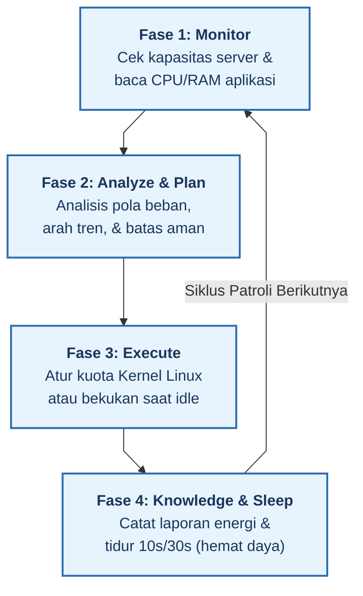
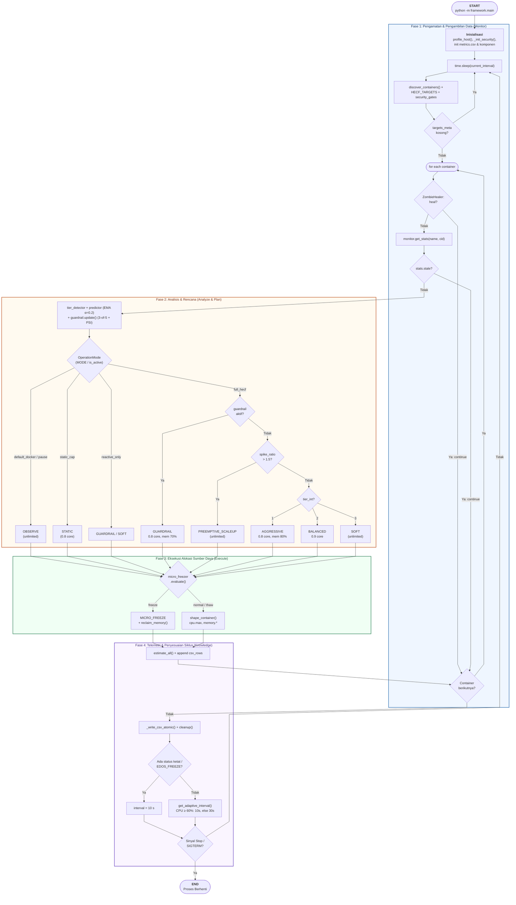

# Alur Kerja Utama HECF (Siklus Kontrol Tertutup)

> **Kategori:** Inovasi Algoritma (S2)
> **Sumber kode:** `framework/main.py` — fungsi `main()` (siklus kontrol per container)

Mengelola sumber daya di dalam server yang menjalankan banyak aplikasi sekaligus bukanlah pekerjaan yang bisa diselesaikan dengan satu kali pengaturan di awal. Beban lalu lintas pengguna selalu berubah sepanjang waktu: aplikasi yang pada pagi hari hampir tidak menerima permintaan bisa saja mendadak kebanjiran pengunjung pada siang hari, lalu kembali sepi pada malam harinya. Jika pembagian CPU dan memori dipatok secara kaku sejak awal, server akan terjebak dalam dua masalah klasik—kekurangan tenaga saat ramai (*bottleneck*), atau justru membuang listrik untuk melayani aplikasi yang sedang menganggur.

Untuk menjawab persoalan tersebut, HECF bekerja layaknya seorang pengawas patroli otomatis yang terus berkeliling secara berkala. Dalam setiap putaran patroli, ia memeriksa kondisi nyata masing-masing aplikasi, menganalisis pola perilakunya dari waktu ke waktu, memutuskan penyesuaian jatah yang paling proporsional, menuliskannya ke sistem operasi, lalu mencatat konsumsi dayanya sebelum beristirahat sejenak untuk putaran berikutnya. Pola kerja berulang yang menjadikan hasil tindakan sebelumnya sebagai bahan evaluasi pada putaran berikutnya ini dikenal sebagai **siklus kontrol tertutup** (*closed-loop control*) berbasis model **MAPE-K** (*Monitor, Analyze, Plan, Execute, Knowledge*).

---

## 1. Gambaran Umum (Siklus Empat Fase MAPE-K)

Secara garis besar, seluruh kerja HECF dapat dirangkum ke dalam empat fase utama yang berputar tanpa henti, dimulai langsung dari Fase 1 tanpa tahapan pemisahan yang rumit.

*Gambar 1. Siklus kontrol empat fase HECF yang berulang secara adaptif.*

Keempat fase tersebut dirancang saling bergantung agar sistem selalu mengambil keputusan berdasarkan keadaan paling mutakhir, bukan asumsi usang. Pada saat pertama kali dijalankan, **Fase 1 (Monitor)** terlebih dahulu mengenali kemampuan dasar perangkat keras server—mulai dari jumlah inti prosesor, kapasitas total memori, hingga ketersediaan sensor pengukur daya listrik—agar setiap batasan yang nanti diambil selalu proporsional terhadap kapasitas fisik server tersebut. Setelah pengenalan awal itu selesai, pada setiap putaran HECF mendata aplikasi apa saja yang sedang aktif dan membaca pemakaian sumber daya aktualnya langsung dari **Kernel Linux**.

Data pengamatan mentah itu kemudian masuk ke **Fase 2 (Analyze & Plan)**. Di sini, HECF tidak serta-merta menghukum atau melonggarkan sebuah aplikasi hanya berdasarkan satu angka sesaat. Ia menggabungkan riwayat kestabilan beban, proyeksi arah perubahan beban ke depan, serta pemeriksaan kondisi darurat sehingga keputusan kuota yang lahir benar-benar matang dan bebas dari reaksi berlebihan. Setelah keputusan ditetapkan, **Fase 3 (Execute)** menerjemahkannya menjadi tindakan nyata melalui Kernel Linux—baik berupa penyesuaian batas CPU dan memori maupun pembekuan sementara bagi aplikasi yang sedang menganggur. Terakhir, **Fase 4 (Knowledge & Sleep)** merekam hasil pengukuran daya dan aktivitas ke dalam berkas laporan telemetri, sekaligus mengatur lama waktu istirahat HECF sendiri sebelum kembali memulai patroli ke Fase 1.

---

## 2. Alur Logika Konseptual per Aplikasi

Diagram di bawah memperinci apa yang terjadi di dalam masing-masing fase untuk setiap aplikasi (container) yang dikelola dalam satu putaran patroli. Alur dibaca dari atas ke bawah; pengelompokan berwarna memisahkan wilayah pengamatan, analisis keputusan, eksekusi ke kernel, serta pencatatan pengetahuan.

```mermaid
%%{init: {'flowchart': {'wrappingWidth': 240, 'padding': 18, 'nodeSpacing': 34, 'rankSpacing': 44, 'curve': 'linear'}}}%%
 flowchart TD
    START(["<b>START</b><br/>Sistem HECF Aktif"]):::term

    %% FASE 1: MONITOR
    subgraph FASE_MONITOR["Fase 1: Pengamatan &amp; Pengambilan Data (Monitor)"]
        direction TB
        SLEEP["<b>Adaptive Sleep</b><br/>Istirahat sejenak:<br/>10s sibuk, 30s tenang"]:::fase1
        DISCOVER["<b>Profiling &amp; Discovery</b><br/>Kenali server di awal,<br/>lalu cari target aktif"]:::fase1
        CEK_TARGET{"Ada Target<br/>Aktif?"}:::decision
        BACA_DATA["<b>Metric Acquisition</b><br/>Baca CPU &amp; memori nyata<br/>dari Kernel Linux"]:::fase1
        CEK_STALE{"Data Terbaca<br/>Valid?"}:::decision
    end

    START --> SLEEP --> DISCOVER --> CEK_TARGET
    CEK_TARGET -->|Tidak| SLEEP
    CEK_TARGET -->|Ya| BACA_DATA --> CEK_STALE

    %% FASE 2: ANALYZE & PLAN
    subgraph FASE_ANALYZE["Fase 2: Analisis Cerdas &amp; Rencana (Analyze &amp; Plan)"]
        direction TB
        EMA["<b>Trend Predictor</b><br/>Perkirakan arah tren<br/>beban ke depan"]:::fase2
        TIER["<b>Tier Detector</b><br/>Evaluasi kestabilan<br/>pola beban aplikasi"]:::fase2
        GUARDRAIL_CHECK{"Beban Darurat?<br/>CPU &gt; 80% / RAM &gt; 90%<br/>(3 dari 5 pantauan)"}:::decision
        PLAN_GUARDRAIL["<b>Aksi: GUARDRAIL</b><br/>Rem darurat ketat:<br/>CPU 0,8 core &amp; RAM 70%"]:::alert
        BURST_CHECK{"Lonjakan<br/>Mendadak?"}:::decision
        PLAN_SCALEUP["<b>PREEMPTIVE SCALE-UP</b><br/>Buka kuota CPU penuh<br/>agar layanan lancar"]:::aksi
        PLAN_TIER["<b>Aksi Karakter Beban</b><br/>Tier 1: Ketat (0,8 core)<br/>Tier 2: Sedang (0,9 core)<br/>Tier 3: Bebas (unlimited)"]:::aksi
    end

    CEK_STALE -->|Valid| EMA
    CEK_STALE -->|Valid| TIER
    EMA --> GUARDRAIL_CHECK
    GUARDRAIL_CHECK -->|Ya: Overload| PLAN_GUARDRAIL
    GUARDRAIL_CHECK -->|Tidak: Aman| BURST_CHECK
    TIER --> BURST_CHECK
    BURST_CHECK -->|Ya: Lonjakan| PLAN_SCALEUP
    BURST_CHECK -->|Tidak: Normal| PLAN_TIER

    %% FASE 3: EXECUTE
    subgraph FASE_EXECUTE["Fase 3: Eksekusi Alokasi Sumber Daya (Execute)"]
        direction TB
        IDLE_CHECK{"Aplikasi<br/>Menganggur?"}:::decision
        ACTION_FREEZE["<b>Aksi: MICRO-FREEZE</b><br/>Bekukan sementara &amp;<br/>pulihkan memori idle"]:::fase3
        ACTION_SHAPE["<b>Aksi: RESOURCE SHAPING</b><br/>Terapkan jatah baru<br/>ke Kernel Linux"]:::fase3
    end

    PLAN_GUARDRAIL --> IDLE_CHECK
    PLAN_SCALEUP --> IDLE_CHECK
    PLAN_TIER --> IDLE_CHECK
    IDLE_CHECK -->|Ya: Idle| ACTION_FREEZE
    IDLE_CHECK -->|Tidak: Aktif| ACTION_SHAPE

    %% FASE 4: KNOWLEDGE
    subgraph FASE_KNOWLEDGE["Fase 4: Telemetri &amp; Penyesuaian Siklus (Knowledge)"]
        direction TB
        HITUNG_DAYA["<b>Energy &amp; Telemetry</b><br/>Hitung daya (Watt/kWh)<br/>&amp; simpan laporan"]:::fase4
        EVAL_INTERVAL{"Sibuk / Ada<br/>Status Ketat?"}:::decision
        SET_FAST["<b>Patroli Cepat: 10s</b><br/>Respon mitigasi sigap"]:::fase4
        SET_SLOW["<b>Hemat Daya: 30s</b><br/>Framework tetap ringan"]:::fase4
        CEK_STOP{"Lanjut Siklus?<br/>(Sistem Aktif)"}:::decision
    end

    END_NODE(["<b>END</b><br/>Sistem Berhenti"]):::term

    ACTION_FREEZE --> HITUNG_DAYA
    ACTION_SHAPE --> HITUNG_DAYA
    HITUNG_DAYA --> EVAL_INTERVAL
    CEK_STALE -.->|Data usang: lewati| EVAL_INTERVAL
    EVAL_INTERVAL -->|Ya| SET_FAST
    EVAL_INTERVAL -->|Tidak| SET_SLOW
    SET_FAST --> CEK_STOP
    SET_SLOW --> CEK_STOP
    CEK_STOP -->|Ya| SLEEP
    CEK_STOP -->|Tidak| END_NODE

    style FASE_MONITOR fill:#eff6ff,stroke:#2b6cb0,stroke-width:2px,color:#1a365d
    style FASE_ANALYZE fill:#fffaf0,stroke:#c05621,stroke-width:2px,color:#7b341e
    style FASE_EXECUTE fill:#f0fff4,stroke:#2f855a,stroke-width:2px,color:#22543d
    style FASE_KNOWLEDGE fill:#faf5ff,stroke:#6b46c1,stroke-width:2px,color:#44337a

    classDef term fill:#edf2f7,stroke:#2d3748,stroke-width:2px,color:#1a202c;
    classDef fase1 fill:#dbeafe,stroke:#2b6cb0,stroke-width:1.5px,color:#1a202c;
    classDef fase2 fill:#feebc8,stroke:#c05621,stroke-width:1.5px,color:#1a202c;
    classDef fase3 fill:#c6f6d5,stroke:#2f855a,stroke-width:1.5px,color:#1a202c;
    classDef fase4 fill:#e9d8fd,stroke:#6b46c1,stroke-width:1.5px,color:#1a202c;
    classDef decision fill:#fefcbf,stroke:#b7791f,stroke-width:1.5px,color:#744210;
    classDef aksi fill:#ebf8ff,stroke:#2b6cb0,stroke-width:1.5px,color:#1a202c;
    classDef alert fill:#fed7d7,stroke:#c53030,stroke-width:1.5px,color:#742a2a;
```

*Gambar 2. Alur logika konseptual MAPE-K untuk setiap aplikasi di dalam satu siklus patroli.*

---

## 3. Penjelasan Analitis Setiap Fase

**Mengapa dimulai dengan jeda dan pengenalan lingkungan (Fase 1)?**  
Alih-alih melakukan pemantauan secara terus-menerus setiap milidetik—yang justru akan menghabiskan tenaga CPU server hanya untuk menjalankan pengawasnya sendiri—HECF memulai setiap siklus dengan jeda tidur yang adaptif (*Adaptive Sleep*). Saat pertama kali aktif, HECF mengenali spesifikasi perangkat keras host agar angka persentase penggunaan sumber daya memiliki konteks kapasitas yang tepat. Pada tiap putaran, ia memindai layanan container yang masuk dalam daftar kelola (*whitelist*), sekaligus mengecualikan komponen kritis seperti basis data atau terowongan jaringan dari pembatasan keras agar layanan vital tidak pernah terganggu. Pembacaan pemakaian CPU dan memori diambil langsung dari catatan Kernel Linux sehingga datanya akurat dan ringan. Jika sebuah container ternyata baru saja dimatikan atau datanya terbaca usang (*stale*), HECF sengaja melewatinya pada putaran tersebut agar tidak menuliskan kuota pada proses yang sudah tidak aktif.

**Bagaimana HECF menyeimbangkan kestabilan dan kecepatan respons (Fase 2)?**  
Inti kecerdasan HECF terletak pada pemisahan antara analisis tren, deteksi bahaya, dan mitigasi lonjakan. Pertama, *Trend Predictor* menghitung arah pergerakan beban menggunakan pemulusan data historis, sementara *Tier Detector* menilai seberapa fluktuatif beban aplikasi dalam jendela pengamatan yang lebih panjang. Informasi dari keduanya masuk ke evaluasi bertingkat yang memiliki prioritas jelas.

Pertimbangan paling utama adalah keselamatan server: **Beban Darurat (Guardrail)**. Apabila penggunaan CPU melampaui 80% atau memori melewati 90% setidaknya dalam tiga dari lima pemeriksaan terakhir, barulah rem darurat diaktifkan. Ambang batas "tiga dari lima" ini sengaja dirancang untuk meredam gangguan sesaat; lonjakan satu detik tidak akan langsung memicu pemotongan kuota, tetapi beban berat yang bertahan konsisten akan segera ditahan dengan kuota CPU ketat (0,8 core) serta pembatasan memori (70% kapasitas host bagi layanan non-prioritas). Menariknya, jika *Trend Predictor* memproyeksikan beban sedang menanjak cepat mendekati zona bahaya, ambang batas CPU tersebut diturunkan lebih awal menjadi 75% sebagai peringatan dini agar penahanan tidak terlambat dilakukan.

Jika kondisi belum masuk kategori darurat, HECF tidak serta-merta membatasi aplikasi. Ia terlebih dahulu memeriksa apakah sedang terjadi **lonjakan mendadak**—yakni ketika beban puncak jauh melampaui beban normalnya. Pada situasi seperti banjir pengunjung secara tiba-tiba, membatasi CPU justru akan menumpuk antrean permintaan dan membuat pengguna menunggu lama. Oleh karena itu, HECF mengambil langkah **Preemptive Scale-Up** dengan melepas batas kuota CPU agar lonjakan permintaan dapat diserap secepat mungkin. Barulah ketika kondisi tergolong normal (tidak darurat dan tidak melonjak tajam), jatah diatur mengikuti karakter historis aplikasi: ketat (0,8 core) bagi beban yang sangat fluktuatif (Tier 1), moderat (0,9 core) bagi beban menengah (Tier 2), dan longgar tanpa batas bagi beban yang tenang dan stabil (Tier 3). Perpindahan antar-tier pun dijaga agar tidak berosilasi liar dengan mensyaratkan tiga pengamatan konsisten berturut-turut.

**Mengapa ada pembedaan antara pengaturan kuota dan pembekuan (Fase 3)?**  
Setelah rencana alokasi terbentuk, HECF melakukan satu pemeriksaan terakhir sebelum menyentuh sistem operasi: apakah aplikasi yang bersangkutan sedang benar-benar menganggur? Dalam praktik komputasi modern, aplikasi web yang menganggur tetap mengonsumsi siklus CPU latar belakang dan menahan cadangan memori. Bagi container non-prioritas yang terbukti diam (melewati batas waktu diam tanpa aktivitas maupun koneksi terbuka), pembatasan kuota biasa belum cukup efisien. HECF menerapkan **Micro-Freeze** yang menjeda eksekusi proses aplikasi tanpa mematikannya, sekaligus mengembalikan sisa memori menganggur ke server. Konsumsi dayanya turun mendekati titik diam perangkat keras, namun aplikasi tetap berada di memori sehingga dapat langsung "dicairkan" dalam hitungan milidetik begitu permintaan baru datang. Sebaliknya, bagi container yang aktif atau tergolong prioritas, HECF langsung menerapkan jatah kuota CPU dan memori hasil Fase 2 ke Kernel Linux (sambil tetap melindungi container prioritas dari pembatasan keras).

**Bagaimana pengetahuan dikumpulkan dan siklus disesuaikan (Fase 4)?**  
Di penghujung evaluasi tiap aplikasi, HECF menghitung estimasi daya listrik (dalam Watt dan energi kWh) secara aditif antara komponen CPU dan memori RAM—memanfaatkan pembacaan sensor daya perangkat keras bila tersedia, atau model matematis terkalibrasi bila berjalan di lingkungan virtual tanpa akses sensor fisik. Data tersebut bersama metrik lainnya dicatat ke tabel laporan secara atomik agar aman dibaca oleh Dashboard. Setelah seluruh container selesai diperiksa, HECF meninjau kondisi keseluruhan: jika ada aplikasi yang sedang berada dalam status ketat (*Guardrail*, *Aggressive*, atau *Balanced*) maupun beban CPU server melebihi 60%, jeda siklus berikutnya dipersingkat menjadi **10 detik** agar pengawasan berlangsung sigap. Sebaliknya, ketika server dalam keadaan tenang, jeda diperpanjang menjadi **30 detik** sehingga beban CPU yang dipakai HECF sendiri tetap minimal (di bawah target overhead 5%).

### Ringkasan Panduan Langkah demi Langkah

| Tahap | Fase | Apa yang Terjadi? | Mengapa Dilakukan? (Tujuan Analitis) |
| :---: | :--- | :--- | :--- |
| **1** | **Monitor** | HECF tidur sejenak (10 atau 30 detik), mengenali kapasitas perangkat keras saat awal aktif, mencari container target, lalu membaca pemakaian CPU dan memori dari Kernel Linux. | Menghindari pemborosan sumber daya oleh proses pemantau itu sendiri dan memastikan setiap pembatasan proporsional terhadap kapasitas fisik server. |
| **2** | **Monitor** | Jika data container gagal terbaca atau usang (*stale*), evaluasi untuk container tersebut dilewati pada putaran itu. | Mencegah sistem salah menjatahkan kuota atau mencatatkan data kosong pada aplikasi yang baru saja berhenti atau restart. |
| **3** | **Analyze & Plan** | Menghitung kestabilan beban historis (*Tier Detector*) dan proyeksi arah tren (*Trend Predictor*), lalu mengecek kondisi darurat (3 dari 5 pantauan) dan lonjakan mendadak. | Memastikan keputusan berbasis tren dan pola nyata, bukan reaksi sesaat; melindungi server dari *overload* sambil tetap menjaga kecepatan respons saat *burst*. |
| **4** | **Execute** | Membekukan sementara aplikasi non-prioritas yang menganggur (*Micro-Freeze*) dan memulihkan memorinya, atau menuliskan kuota CPU/memori baru ke Kernel Linux. | Memangkas konsumsi listrik aplikasi yang menganggur hingga mendekati nol tanpa mematikan aplikasi, dan mengisolasi batas sumber daya aplikasi yang aktif. |
| **5** | **Knowledge** | Menghitung konsumsi daya (Watt & kWh), menyimpan laporan telemetri, dan menyesuaikan interval patroli berikutnya (10 detik jika sibuk/ketat, 30 detik jika tenang). | Menyediakan rekam jejak eksperimen yang akurat sekaligus menyeimbangkan kecepatan mitigasi dengan efisiensi framework itu sendiri. |

---

## 4. Detail Teknis Kode Aktual (`framework/main.py`)

Diagram di bawah memetakan alur kode aktual di `framework/main.py` ke dalam empat fase berwarna, beserta mode operasional eksperimen (`default_docker`, `static_cap`, `reactive_only`, dan `full_hecf`) serta titik integrasi ekstensi keamanan opsional.

> **Catatan Teknis Implementasi:**
> 1. Container yang di-*heal* oleh `ZombieHealer`, diisolasi oleh `sandbox`, atau datanya bertanda `stale` langsung melewati fase penentuan kuota normal (`continue`).
> 2. Jika ekstensi `edos_guard` memicu aksi `"freeze"`, keputusan mode ditimpa menjadi `EDOS_FREEZE` dan container dibekukan langsung oleh `micro_freezer._freeze()`.
> 3. Saat dinonaktifkan melalui toggle Dashboard (`framework_status.json` dengan `active = false`), semua target otomatis berada pada aksi `OBSERVE`.
> 4. Nilai kuota CPU mengacu pada periode `cpu.max` 100.000 µs (`80000` = 0,8 core, `90000` = 0,9 core, `-1` = `"max"` / tanpa batas, dengan batas bawah pengaman 0,2 core di `shaper.py`).
> 5. Pada `_write_csv_atomic()`, rotasi berkas `metrics.csv` dinonaktifkan secara bawaan (`HECF_CSV_ROTATE=false`) untuk mencegah galat `[Errno 16] Device or resource busy` pada *single-file bind mount* Docker dan menjaga keutuhan data eksperimen multi-jam (jika diaktifkan, rotasi dilakukan secara *in-place copy*).
> 6. `MicroFreezer` terhubung langsung ke thread latar belakang `WatchdogThaw` sehingga container yang dibekukan (`cgroup.freeze = 1`) dijamin cair kembali secara sub-detik setelah mencapai batas maksimum durasi beku (`1000 ms`), tanpa harus menunggu putaran `time.sleep(current_interval)` berikutnya.

---

## 5. Glosarium

* **MAPE-K (*Monitor, Analyze, Plan, Execute, Knowledge*)**: Pola standar komputasi otonom yang memungkinkan sistem mengamati kondisinya sendiri, menganalisis situasi, merencanakan penyesuaian, mengeksekusi tindakan, dan menyimpan pengetahuan untuk perbaikan berkelanjutan.
* **Kernel Linux**: Bagian inti sistem operasi yang mengatur pembagian sumber daya fisik (CPU dan memori) secara adil dan terisolasi kepada setiap aplikasi yang berjalan.
* **Jatah Kuota Sumber Daya**: Batas maksimum tenaga CPU (dalam satuan core) dan kapasitas memori yang diperbolehkan bagi suatu aplikasi pada satu waktu.
* **Rem Darurat (*Guardrail*)**: Mekanisme perlindungan otomatis yang membatasi jatah secara ketat apabila pemakaian CPU melampaui 80% atau memori melampaui 90% pada minimal tiga dari lima pemeriksaan terakhir.
* **Pola Kestabilan Beban (*Tier*)**: Klasifikasi perilaku beban aplikasi berdasarkan riwayatnya: Tier 1 untuk beban yang sangat fluktuatif/sering melonjak, Tier 2 untuk fluktuasi menengah, dan Tier 3 untuk beban yang relatif stabil.
* **Pre-emptive Scale-Up**: Kebijakan melepas batas kuota CPU ketika terdeteksi lonjakan permintaan mendadak agar aplikasi mampu menyerap lonjakan tersebut tanpa menimbulkan antrean atau perlambatan (*lag*).
* **Micro-Freeze & Thaw**: Proses menjeda container non-prioritas yang menganggur agar konsumsi dayanya mendekati nol sambil memulihkan memori yang tidak terpakai (*freeze*), lalu mengaktifkannya kembali dalam sekejap saat ada permintaan baru (*thaw*).
* **Jeda Adaptif (*Adaptive Sleep*)**: Pengaturan waktu tunggu antarsiklus patroli (10 detik saat sibuk/kritis dan 30 detik saat tenang) agar framework pengawas tidak ikut membebani server.
* *(Teknis)* **cgroups v2**: Fitur manajemen sumber daya pada Kernel Linux modern (`cpu.stat`, `cpu.max`, `memory.*`, `cgroup.freeze`) yang digunakan HECF untuk membaca metrik dan menerapkan batasan secara langsung.
* *(Teknis)* **Stale Data**: Kondisi ketika data metrik tidak dapat dibaca dengan valid (misalnya karena container baru saja berhenti), sehingga sistem melewatinya pada putaran tersebut.
* *(Teknis)* **Hysteresis**: Mekanisme peredam osilasi yang mensyaratkan perubahan kondisi teramati secara konsisten selama tiga sampel berturut-turut sebelum perpindahan Tier resmi diberlakukan.
