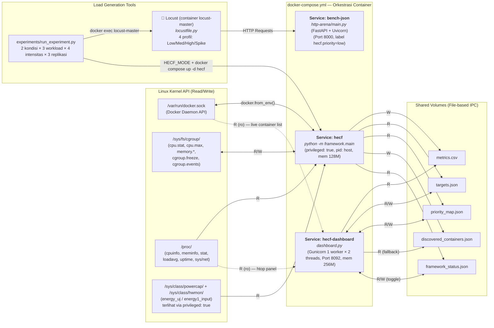
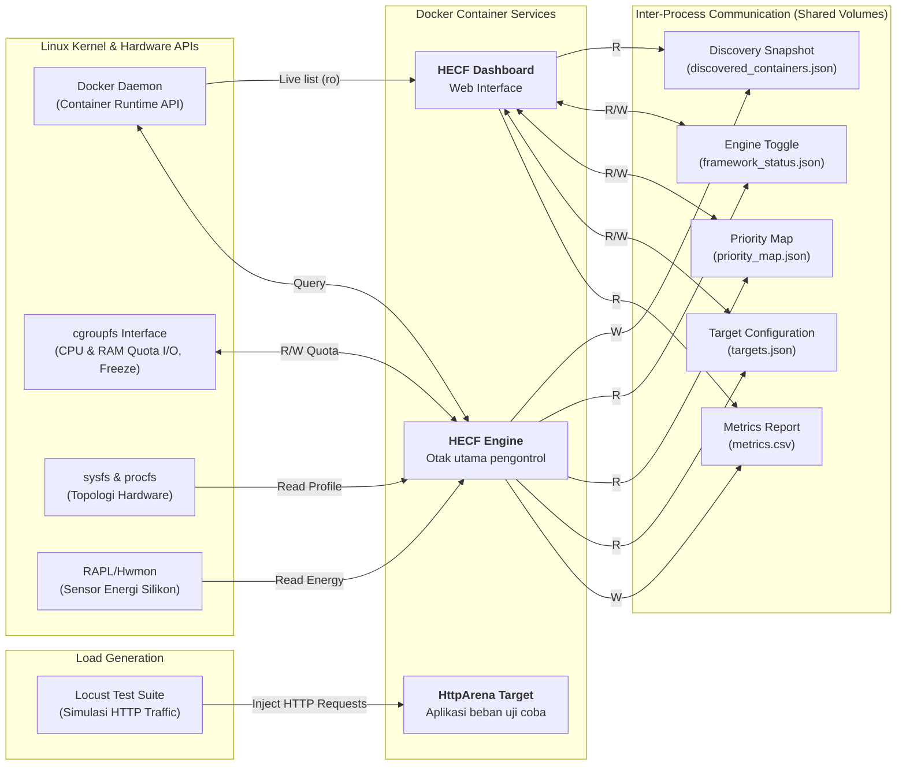

# Diagram Tools — Infrastruktur Teknologi HECF

> **Kategori:** Tools / Engineering Support (S1)
> **Sumber:** `docker-compose.yml`, `Dockerfile`, `requirements.txt`, `http-arena/`, `experiments/run_experiment.py`

Diagram ini menunjukkan **tumpukan teknologi (technology stack)** yang digunakan HECF — Docker, Linux Kernel, Locust, HttpArena — dan bagaimana mereka terhubung secara infrastruktur. Ini BUKAN algoritma, melainkan *tools* yang menjadi wadah eksekusi algoritma.

> **Catatan:** `experiments/run_experiment.py` menjalankan `docker compose` dari direktori `../portfolio-app` (compose utama server), tempat container `locust-master` berada. `docker-compose.yml` di repo ini hanya mendefinisikan `hecf`, `hecf-dashboard`, dan `bench-json`.

## Pemetaan File → Infrastruktur

| File | Peran | Kategori |
| --- | --- | --- |
| `docker-compose.yml` | Konfigurasi deployment 3 service (`hecf`, `hecf-dashboard`, `bench-json`) | Infrastruktur |
| `Dockerfile` | Build image Python 3.10-slim + dependencies, `CMD python -m framework.main` | Infrastruktur |
| `requirements.txt` | docker, numpy, requests, pytest, locust, Flask, gunicorn | Infrastruktur |
| `dashboard.py` | Web UI visualisasi 5 metrik + Managed Containers + htop panel | Tools (S1) |
| `http-arena/main.py` | Benchmark workload FastAPI (`/` JSON, `/static/dummy.txt`, `/db`) | Tools (S1) |
| `locustfiles/locustfile.py` | Generator beban lalu lintas (`WORKLOAD_TYPE` = json/static/db/all) | Tools (S1) |
| `experiments/run_experiment.py` | Orkestrasi matriks 72 run + arsip hasil | Metodologi |
| `targets.json`, `priority_map.json`, `framework_status.json` | Shared state antar proses (UI → engine) | Infrastruktur |
| `discovered_containers.json` | Snapshot discovery (engine → UI, fallback) | Infrastruktur |
| `metrics.csv` | Data bridge engine → dashboard / eksperimen | Infrastruktur |

---

## Alur Logika Konseptual

---

## 🔌 Hubungan Infrastruktur dengan Algoritma (HECF Engine)

Jika `big_picture.md` dan `main_control_loop.md` membahas otak dari algoritma (isi dari folder `framework/`), maka diagram infrastruktur di atas menunjukkan **rumah dan lingkungan** di mana algoritma tersebut hidup.

1. **HECF Engine (`framework/main.py`)**: Ini adalah blok utama yang menjalankan seluruh *codingan* algoritma yang dijelaskan di file sebelumnya. Diinjeksi dalam bentuk _container_ mandiri lewat `docker-compose.yml` dengan `privileged: true` dan `pid: host` agar bisa menulis cgroups host dan membaca `/proc` host.
2. **Dashboard (`dashboard.py`)**: Algoritma HECF Engine tidak memiliki tampilan grafis. Oleh karena itu, *engine* menulis hasil hitungannya ke file `metrics.csv`. Dashboard membaca ~200 baris terakhir file tersebut dan menampilkannya di browser. Dashboard juga menulis `targets.json` (whitelist), `priority_map.json` (prioritas), dan `framework_status.json` (pause/resume engine). Daftar container di panel *Managed Containers* diambil langsung dari Docker socket (read-only), dengan `discovered_containers.json` sebagai fallback.
3. **Pemberi Beban (`locustfile.py`)**: Untuk membuktikan apakah algoritma di Layer 3 dan Layer 4 berfungsi dengan baik menahan beban, sistem membutuhkan simulasi _traffic_. Locust yang mengambil peran ini, dijalankan oleh `run_experiment.py` lewat `docker exec locust-master`.
4. **Target (`http-arena/main.py`)**: Kontainer aplikasi FastAPI (dummy) yang berperan sebagai server web dengan 3 endpoint (JSON, Static, Async DB). Algoritma HECF Engine (*Layer 2*) memonitor kontainer ini, sementara Locust menembaknya dengan _traffic_.
