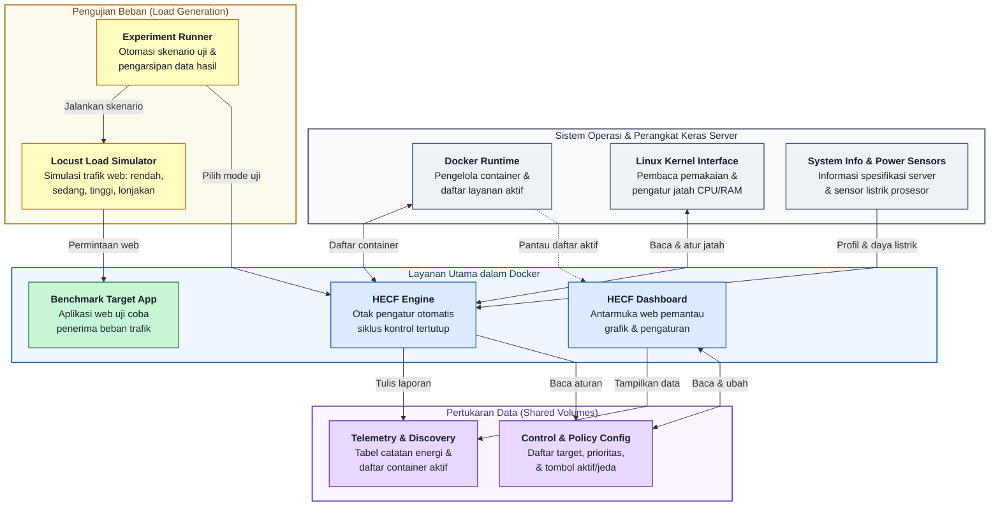
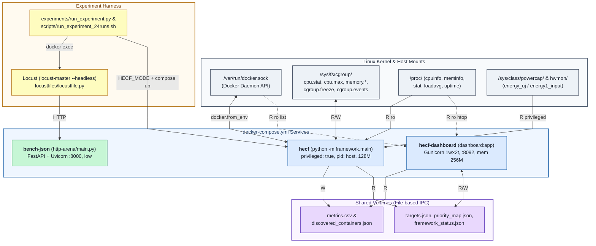

# Infrastruktur dan Alat Pendukung HECF

> **Kategori:** Tools & Engineering Support (S1)
> **Sumber kode:** `docker-compose.yml`, `Dockerfile`, `requirements.txt`, `http-arena/`, `locustfiles/`, `experiments/run_experiment.py`

Jika `big_picture.md` dan `main_control_loop.md` membahas cara HECF berpikir dan mengambil keputusan, dokumen ini membahas **ekosistem tempat algoritma tersebut dijalankan, dipantau, dan diuji**. Komponen-komponen yang digambarkan di sini bukanlah bagian dari logika kontrol cerdasnya, melainkan pondasi infrastruktur—mulai dari sistem operasi Linux, pengelola container Docker, mekanisme pertukaran berkas, antarmuka web, hingga simulator lalu lintas pengguna—yang memungkinkan HECF bekerja di lingkungan nyata sekaligus diuji secara ilmiah dan berulang.

---

## 1. Alur Logika Konseptual Infrastruktur

Diagram di bawah memetakan empat kelompok komponen infrastruktur dari atas ke bawah: perangkat keras, alat pengujian, layanan utama, dan ruang pertukaran laporan serta pengaturan.

*Gambar 1. Ekosistem infrastruktur, layanan container, pertukaran data, dan alat uji HECF.*

---

## 2. Penjelasan Analitis Hubungan Infrastruktur dengan Algoritma

Seluruh ekosistem pengujian HECF dijalankan di atas satu server Linux menggunakan orkestrasi Docker. Pemilihan pendekatan berbasis container ini memiliki alasan praktis sekaligus metodologis: setiap layanan terisolasi satu sama lain dengan batas memori masing-masing, sehingga seluruh sistem dapat dibongkar-pasang ulang dengan konfigurasi yang identik untuk menjamin eksperimen dapat direproduksi secara konsisten.

**Bagaimana HECF Engine berinteraksi langsung dengan mesin host.** Meskipun berjalan di dalam container terpisah agar rapi dan mudah disebarkan, **HECF Engine** harus mampu melihat dan mengendalikan container lain pada server yang sama. Oleh karena itu, container Engine diberi hak akses khusus terhadap sistem host sehingga ia dapat berkomunikasi dengan tiga fasilitas utama server: **Docker Runtime** untuk mengetahui daftar layanan yang sedang hidup, **Linux Kernel Interface** untuk membaca pemakaian sumber daya aktual sekaligus mengirimkan batas jatah baru atau perintah pembekuan, serta **sensor informasi sistem dan daya prosesor** agar kalkulasi energinya bertumpu pada spesifikasi fisik dan pembacaan daya nyata (bila tersedia).

**Mengapa Dashboard dan Engine berkomunikasi lewat berkas bersama (*Shared Volumes*).** Di sisi antarmuka pengguna, **HECF Dashboard** berperan sebagai panel kontrol web bagi peneliti maupun operator. Alih-alih menghubungkan Dashboard dan Engine melalui jalur jaringan API yang saling mengunci (*tight coupling*), arsitektur ini memilih pola pertukaran data melalui **berkas bersama**. Engine menuliskan catatan energi, metrik CPU/RAM, dan daftar container terdeteksi ke berkas laporan, sedangkan Dashboard membacanya untuk disajikan dalam bentuk grafik pemantauan. Sebaliknya, ketika operator memilih aplikasi target, mengubah tingkat prioritas layanan, atau menekan tombol jeda melalui Dashboard, perubahan tersebut disimpan ke berkas konfigurasi bersama untuk dibaca Engine pada siklus patroli berikutnya. Desain terpisah (*decoupled*) ini memberikan ketahanan operasional yang tinggi: seandainya tampilan Dashboard mengalami gangguan atau dimuat ulang, HECF Engine tetap berjalan menstabilkan server tanpa terhenti.

**Bagaimana efektivitas algoritma dibuktikan secara terukur.** Untuk membuktikan bahwa algoritma di balik HECF mampu menghemat konsumsi listrik tanpa merusak kecepatan respons aplikasi, sistem membutuhkan objek uji dan beban lalu lintas yang terkendali. Peran objek uji dijalankan oleh **Benchmark Target App**—sebuah server web ringan yang melayani beberapa jenis beban kerja—sementara **Locust Load Simulator** bertindak sebagai ribuan pengguna tiruan yang menembakkan permintaan web dalam berbagai pola intensitas (beban rendah, sedang, tinggi, hingga lonjakan tiba-tiba). Seluruh rangkaian eksperimen tersebut diorkestrasi oleh **Experiment Runner** yang mengganti-ganti mode operasi HECF (sebagai pembanding dengan kondisi standar) serta mengarsipkan hasil pengukuran secara otomatis untuk dianalisis dalam tesis.

---

## 3. Detail Teknis Infrastruktur

Diagram teknis berikut merinci jalur berkas sistem operasi, konfigurasi `docker-compose.yml`, port layanan, dan nama berkas IPC aktual di repositori.

> **Catatan Deployment & Tahapan Eksperimen (Total 49,6 Jam):**
> 1. Pada server produksi/uji (`srv-laptop`), seluruh layanan utama (`hecf`, `hecf-dashboard`, `bench-json`, `locust-master`, beserta tunnel Cloudflare) diorkestrasi terpusat melalui `../portfolio-app/docker-compose.yml` di jaringan `portfolio-network`, sedangkan berkas state bersama (`targets.json`, `metrics.csv`, dll.) di-mount dari direktori `green-container-framework`.
> 2. Eksperimen HECF terdiri dari tiga tahap: **(A) Pilot** 72 run / 24 jam (`experiments/run_experiment.py`, sudah selesai dan mengungkap cacat desain awal), **(B) Proof-of-Concept (PoC)** 24 run / 6,4 jam (`./scripts/run_experiment_24runs.sh`, 6 blok × 4 mode @ 16 menit untuk validasi mekanisme dan statistik minimum Wilcoxon $n=6$), dan **(B+) Main Experiment** 72 run / 19,2 jam (`REPLICATIONS=3 ./scripts/run_experiment_24runs.sh`, untuk klaim utama H1 & H2 setelah Tahap B lulus Gate 2).

### Pemetaan File ke Infrastruktur

| File / Path | Peran Teknis | Kategori |
| --- | --- | --- |
| `docker-compose.yml` | Orkestrasi service (`hecf` batas memori 128M dengan mount `/sys/class/powercap:ro`, `hecf-dashboard` batas 256M pada port 8092, `bench-json` pada port 8000, dan `locust-master` headless) beserta volume mount host. | Infrastruktur |
| `Dockerfile` | Image berbasis Python 3.10-slim beserta dependensi sistem dan perintah eksekusi utama `python -m framework.main`. | Infrastruktur |
| `requirements.txt` | Daftar pustaka Python (`docker`, `numpy`, `requests`, `pytest`, `locust`, `Flask`, `gunicorn`). | Infrastruktur |
| `dashboard.py` | Aplikasi web Flask (dijalankan dengan Gunicorn 1 worker × 2 threads) untuk visualisasi metrik, panel *Managed Containers*, dan pemantau host. | Tools (S1) |
| `http-arena/main.py` & `http-arena/Dockerfile` | Layanan web uji berbasis FastAPI + Uvicorn (dilengkapi `stress-ng` untuk verifikasi cgroups v2 manual) yang menyediakan endpoint JSON (`/`), berkas statis (`/static/dummy.txt`), dan endpoint basis data (`/db`). | Tools (S1) |
| `locustfiles/locustfile.py` | Skrip simulator beban lalu lintas HTTP dengan dukungan variasi profil beban dan jenis workload (`json`, `static`, `db`, `all`). | Tools (S1) |
| `experiments/run_experiment.py` | Pengendali skenario eksperimen Tahap A (Pilot 72 run / 24 jam) lintas mode, workload, intensitas, dan replikasi. | Metodologi |
| `scripts/run_experiment_24runs.sh` & `scripts/analyze_24runs.py` | Orkestrator otomatis RCBD Tahap B (24 run / 6,4 jam) & Tahap B+ (72 run / 19,2 jam) dengan 4 fase beban Locust headless, pembacaan RAPL langsung, manipulation check, serta uji statistik Paired Wilcoxon, Cohen's $d$, 95% CI, dan koreksi Holm-Bonferroni (100% Python stdlib). | Metodologi |
| `targets.json`, `priority_map.json`, `framework_status.json` | Berkas konfigurasi bersama yang ditulis oleh Dashboard UI dan dibaca secara berkala oleh HECF Engine. | Infrastruktur (IPC) |
| `discovered_containers.json` | Snapshot daftar container non-excluded yang ditulis oleh Engine dan dibaca Dashboard dalam mode *read-only*. | Infrastruktur (IPC) |
| `metrics.csv` | Jembatan data telemetri 16 kolom yang ditulis atomik oleh Engine untuk dibaca Dashboard maupun analisis pasca-eksperimen. | Infrastruktur (IPC) |
