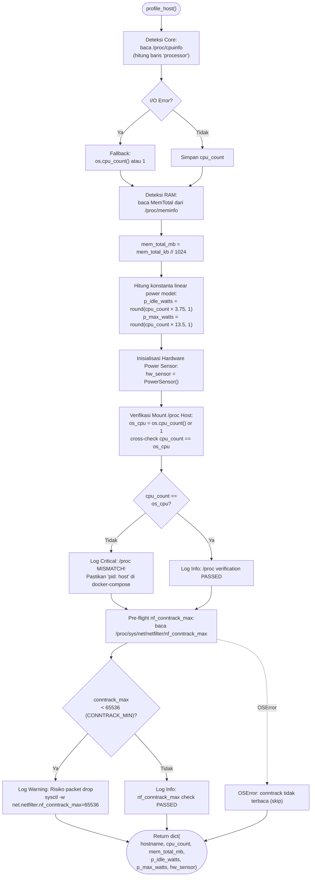
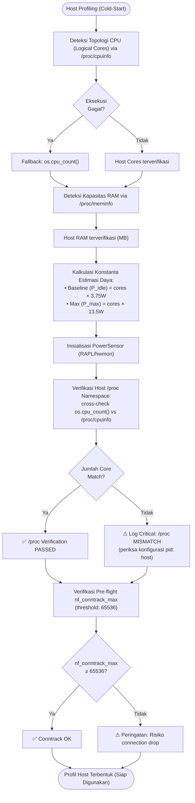

# Flowchart — profiler.profile_host() (Layer 1)

> **Kode Sumber:** `framework/profiler.py` → fungsi `profile_host()` (baris 20–91)
> **Posisi di Diagram:** Layer 1 — Environment Profiler → Host Detection
> **Kategori:** 🛠️ TOOLS & INFRASTRUKTUR (S1)

Sistem profilasi otomatis host saat cold-start. Membaca topologi CPU dan memori secara dinamis dari `/proc`, menginisialisasi modul sensor perangkat keras (`hardware_sensor.PowerSensor`), memverifikasi namespace host (`pid: host`), dan melakukan pre-flight check batas `nf_conntrack_max`.

---

## Alur Logika Konseptual

