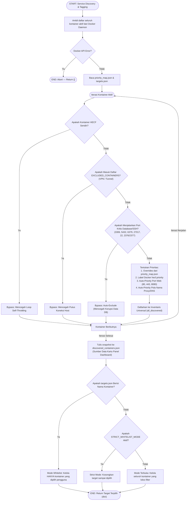

# Flowchart — profiler.discover_containers() (Layer 1)

> **Kode Sumber:** `framework/profiler.py` → fungsi `discover_containers()` (baris 94–266)
> **Posisi di Diagram:** Layer 1 — Environment Profiler → Container Discovery & Tagging
> **Kategori:** 🛠️ TOOLS & INFRASTRUKTUR (S1)

Sistem penemuan kontainer otomatis melalui Docker SDK (`docker.from_env()`). Mengimplementasikan penyaringan multi-tahap: eliminasi kontainer internal HECF, daftar eksklusi statis (`EXCLUDED_CONTAINERS`), deteksi port kritis database/SSH (`CRITICAL_PORTS_EXCLUDE`), auto-priority untuk layanan web dan proxy (`CRITICAL_PORTS_PRIORITY` & `NETWORK_INFRA_PATTERNS`), integrasi status dinamis (`priority_map.json` dan `targets.json`), pencatatan snapshot (`discovered_containers.json`), dan penerapan filter whitelist.

```mermaid
flowchart TD
    START(["discover_containers()"])

    CONNECT["Connect ke Docker Daemon (docker.from_env())<br/>running = client.containers.list()"]
    CONN_ERR{"Koneksi gagal?"}
    RETURN_EMPTY(["Return {}"])

    READ_SHARED["Baca shared state:<br/>• priority_map.json<br/>• targets.json (targets_whitelist)"]

    LOOP(["FOR EACH c in running"])

    CHECK_SELF{"self_hostname<br/>in c.id?"}
    SKIP_SELF["Skip (Hindari self-managing HECF)"]

    CHECK_EXCLUDED{"name in<br/>EXCLUDED_CONTAINERS?<br/>(hecf, cloudflared, tailscale, wireguard)"}
    SKIP_EXCLUDED["Skip (Infrastruktur kritis mutlak)"]

    PARSE_PORTS["Parse bound_ports dari c.ports"]
    PORT_EXCLUDE{"Port ada di<br/>CRITICAL_PORTS_EXCLUDE?<br/>(DB: 3306, 5432, 6379, 27017, dll<br/>SSH: 22; Docker: 2376/2377)"}
    SKIP_PORT_EXCLUDE["Log [AUTO-EXCLUDE]: binds port kritis<br/>Skip container dari HECF"]

    PORT_PRIO{"Port ada di<br/>CRITICAL_PORTS_PRIORITY?<br/>(Web: 80, 443, 8080, 8443; DNS: 53; NTP: 123)"}
    SET_PORT_PRIO["Set auto_priority_reason<br/>(e.g. 'port 80 (HTTP)')"]

    CHECK_PRIO_MAP{"name in<br/>priority_map.json?"}
    PRIO_FROM_MAP["priority = (priority_map[name] == 'high')"]
    CHECK_LABEL{"Label Docker<br/>'hecf.priority' == 'high'?"}
    PRIO_FROM_LABEL["priority = True"]
    PRIO_DEFAULT["priority = False"]

    OVERRIDE_PORT_PRIO{"auto_priority_reason<br/>ada & priority==False?"}
    APPLY_PORT_PRIO["priority = True<br/>Log [AUTO-PRIORITY]"]

    CHECK_NET_INFRA{"name / image cocok pattern di<br/>NETWORK_INFRA_PATTERNS?<br/>(nginx, caddy, traefik, haproxy, envoy, tailscale, dll)"}
    APPLY_NET_PRIO["priority = True<br/>Log [AUTO-PRIORITY] infra pattern"]

    REGISTER["Simpan ke all_discovered[name]:<br/>{id, priority, pid, image, status, ports, auto_reason}"]
    NEXT["Lanjut ke container berikutnya"]

    WRITE_DISC["Tulis discovered_containers.json<br/>(Semua kontainer discoverable untuk UI Dashboard)"]

    CHECK_WL{"targets_whitelist<br/>tidak kosong?"}
    WL_FILTER["Mode Whitelist:<br/>targets = all_discovered difilter hanya yang ada di targets.json"]
    CHECK_STRICT{"STRICT_WHITELIST_MODE<br/>== True?"}
    STRICT_EMPTY["targets = {}<br/>(Tolak kelola apa pun sampai whitelist diisi)"]
    OPEN_MODE["Open Mode (Default):<br/>targets = all_discovered (kelola semua yang ditemukan)"]

    RETURN(["Return targets (dict: name -> meta)"])

    START --> CONNECT
    CONNECT --> CONN_ERR
    CONN_ERR -->|Ya| RETURN_EMPTY
    CONN_ERR -->|Tidak| READ_SHARED
    READ_SHARED --> LOOP

    LOOP --> CHECK_SELF
    CHECK_SELF -->|Ya| SKIP_SELF
    CHECK_SELF -->|Tidak| CHECK_EXCLUDED
    SKIP_SELF --> NEXT

    CHECK_EXCLUDED -->|Ya| SKIP_EXCLUDED
    CHECK_EXCLUDED -->|Tidak| PARSE_PORTS
    SKIP_EXCLUDED --> NEXT

    PARSE_PORTS --> PORT_EXCLUDE
    PORT_EXCLUDE -->|Ya| SKIP_PORT_EXCLUDE
    PORT_EXCLUDE -->|Tidak| PORT_PRIO
    SKIP_PORT_EXCLUDE --> NEXT

    PORT_PRIO -->|Ya| SET_PORT_PRIO
    PORT_PRIO -->|Tidak| CHECK_PRIO_MAP
    SET_PORT_PRIO --> CHECK_PRIO_MAP

    CHECK_PRIO_MAP -->|Ya| PRIO_FROM_MAP
    CHECK_PRIO_MAP -->|Tidak| CHECK_LABEL
    CHECK_LABEL -->|Ya| PRIO_FROM_LABEL
    CHECK_LABEL -->|Tidak| PRIO_DEFAULT

    PRIO_FROM_MAP --> OVERRIDE_PORT_PRIO
    PRIO_FROM_LABEL --> OVERRIDE_PORT_PRIO
    PRIO_DEFAULT --> OVERRIDE_PORT_PRIO

    OVERRIDE_PORT_PRIO -->|Ya| APPLY_PORT_PRIO
    OVERRIDE_PORT_PRIO -->|Tidak| CHECK_NET_INFRA
    APPLY_PORT_PRIO --> CHECK_NET_INFRA

    CHECK_NET_INFRA -->|Ya (dan priority==False)| APPLY_NET_PRIO
    CHECK_NET_INFRA -->|Tidak| REGISTER
    APPLY_NET_PRIO --> REGISTER

    REGISTER --> NEXT
    NEXT -->|Masih ada| LOOP
    NEXT -->|Selesai| WRITE_DISC

    WRITE_DISC --> CHECK_WL
    CHECK_WL -->|Ya| WL_FILTER
    CHECK_WL -->|Tidak| CHECK_STRICT
    CHECK_STRICT -->|Ya| STRICT_EMPTY
    CHECK_STRICT -->|Tidak| OPEN_MODE

    WL_FILTER --> RETURN
    STRICT_EMPTY --> RETURN
    OPEN_MODE --> RETURN
```

---

## Alur Logika Konseptual


