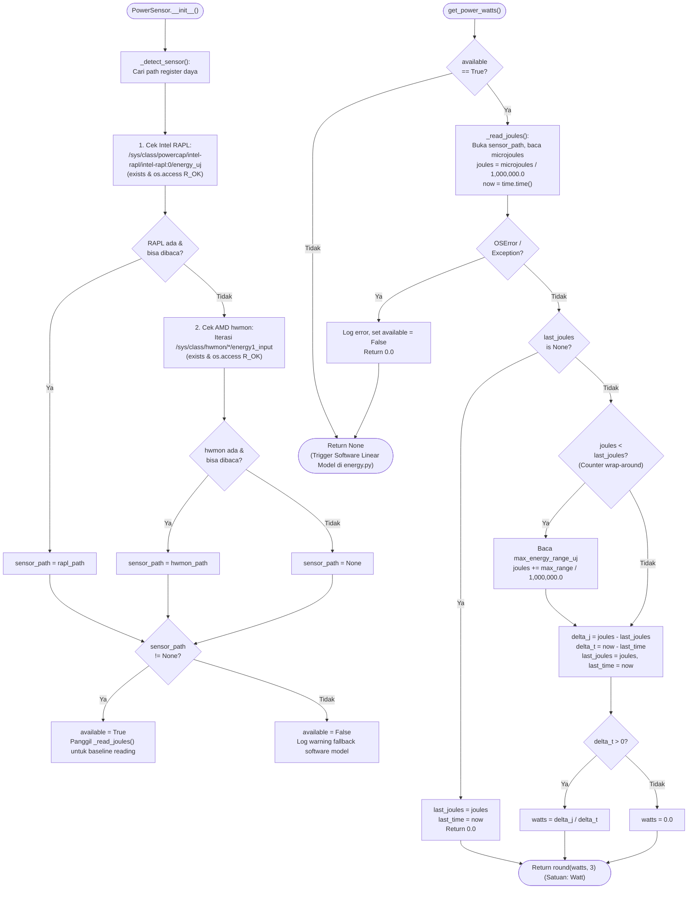
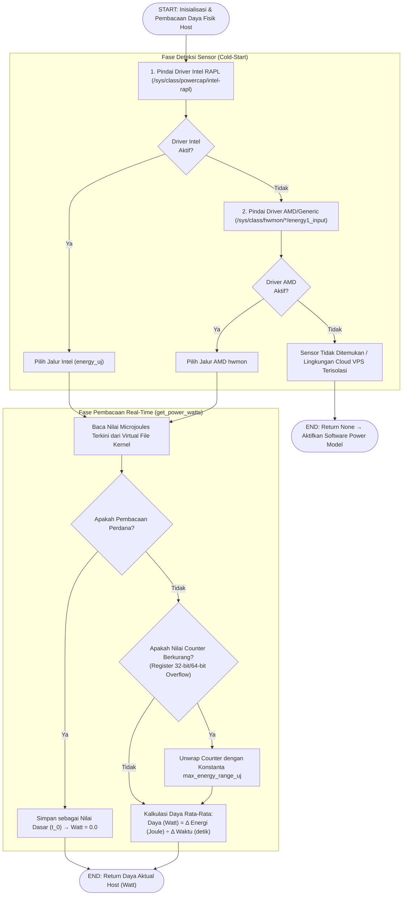

# Flowchart — hardware_sensor.PowerSensor (Layer 1)

> **Kode Sumber:** `framework/hardware_sensor.py` → class `PowerSensor`, fungsi `_detect_sensor()`, `_read_joules()`, dan `get_power_watts()` (baris 12–97)
> **Posisi di Diagram:** Layer 1 — Environment Profiler → Hardware Power Sensor Detection & Acquisition
> **Kategori:** 🛠️ TOOLS & INFRASTRUKTUR (S1)

Modul pembaca sensor daya fisik tingkat motherboard/silikon. Mendeteksi register energi Intel RAPL (`/sys/class/powercap/intel-rapl/intel-rapl:0/energy_uj`) atau AMD Energy (`/sys/class/hwmon/*/energy1_input`). Dilengkapi perlindungan pembacaan baseline pertama dan unwrap register counter saat overflow (`max_energy_range_uj`). Jika tidak tersedia (misal di cloud VPS tanpa virtual RAPL), modul fallback dengan aman dan mengembalikan `None`.

---

## Alur Logika Konseptual

