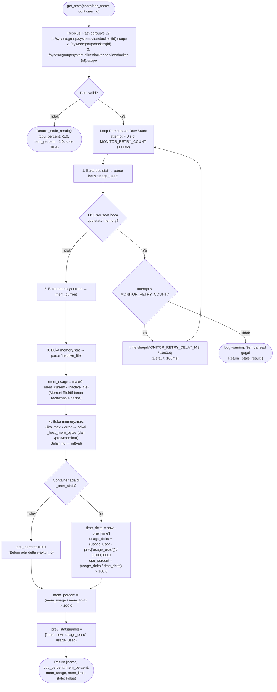
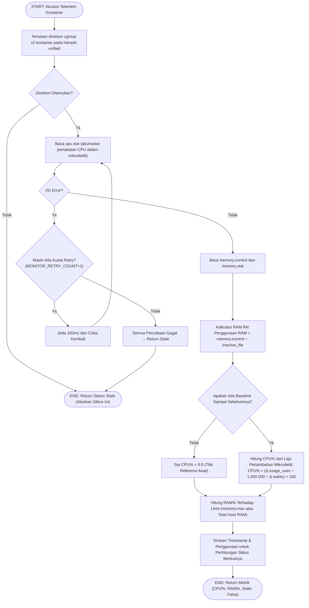
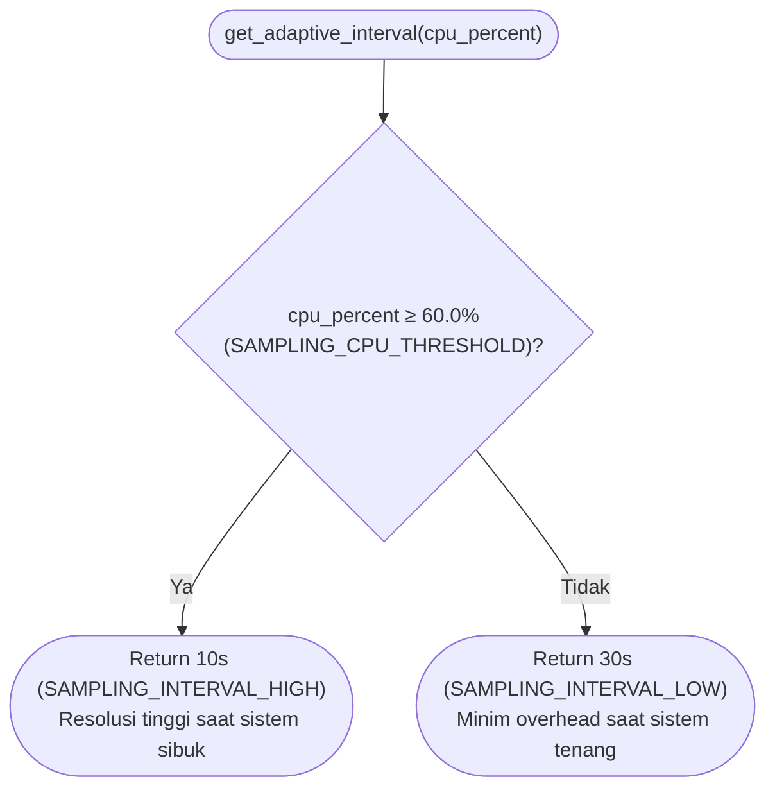

# Flowchart — Monitor.get_stats() (Layer 2)

> **Kode Sumber:** `framework/monitor.py` → class `Monitor`, fungsi `get_stats()`, `_read_raw_stats()`, dan `get_adaptive_interval()` (baris 19–186)
> **Posisi di Diagram:** Layer 2 — Monitoring Engine → Direct cgroupfs v2 Read & Adaptive Polling
> **Kategori:** 🌟 INOVASI ALGORITMA (S2)

Algoritma pembacaan telemetri kernel secara langsung tanpa perantara Docker REST API. Membaca `cpu.stat` (akumulasi mikrodetik pemrosesan CPU) dan `memory.current` dikurangi `inactive_file` dari `memory.stat` untuk mengecualikan page cache kernel yang dapat direklamasi. Dilengkapi mekanisme retry (`MONITOR_RETRY_COUNT=1`, jeda 100ms) dan penanda `stale: True` agar main control loop tidak melakukan pemotongan kuota saat kontainer mati.

---

## Alur Logika Konseptual

### 1. Akuisisi Metrik Kernel Langsung

---

### 2. Penyesuaian Interval Pemantauan Adaptif (`get_adaptive_interval`)

