# Flowchart — Guardrail.update() (Layer 3A)

> **Kode Sumber:** `framework/guardrail.py` → class `Guardrail`, fungsi `update()`, `_get_effective_cpu_threshold()`, dan `_read_psi()` (baris 34–150)
> **Posisi di Diagram:** Layer 3 — Hybrid Control Engine → 3A Reactive Emergency Guardrail
> **Kategori:** 🌟 INOVASI ALGORITMA (S2)

Algoritma **Reactive Debouncing** menggunakan Rolling Boolean Array. Mencegah false-positive pada micro-spike dengan aturan **3 dari 5 sampel (3-of-5)**. Dilengkapi dengan:
1. **EMA Pre-Warning:** Bila prediksi tren EMA mendekati ambang batas (`ema_pred ≥ 75.0%`), ambang batas darurat diturunkan dari 80.0% menjadi 75.0% untuk sensitivitas dini.
2. **Derivative Pre-emptive Trigger:** Jika laju kenaikan EMA sangat tinggi (`d(EMA)/dt > 5.0`) saat beban sudah signifikan (`EMA > 50.0%`), status overload langsung dipicu sebelum menabrak ambang batas keras.
3. **Pressure Stall Information (PSI) Confirmation:** Konfirmasi kernel Linux via `cpu.pressure` (`some avg10 > 25.0`) untuk menandai tingkat keyakinan tinggi (`GUARDRAIL+PSI`).

```mermaid
flowchart TD
    START(["Guardrail.update(container_name, cpu, mem,<br/>ema_pred, ema_derivative, cgroup_path)"])

    CHECK_EMA_PRED{"ema_pred<br/>tersedia?<br/>(Hanya di full_hecf)"}
    CHECK_ZONE{"ema_pred ≥ 75.0%<br/>(80% - PRE_WARNING_MARGIN 5%)?"}
    THRESH_LOW["cpu_thresh = 75.0%<br/>(Sensitivitas Dini EMA)"]
    THRESH_NORMAL["cpu_thresh = 80.0%<br/>(Ambang Batas Default)"]

    CHECK_DERIV{"ema_derivative &gt; 5.0<br/>DAN ema_pred &gt; 50.0%?"}
    SET_DERIV_TRUE["derivative_triggered = True<br/>(Pemicu Proaktif Laju Lonjakan)"]
    SET_DERIV_FALSE["derivative_triggered = False"]

    EVAL_OVERLOAD["Evaluasi Status Overload Sampel (t):<br/>is_over = (cpu &gt; cpu_thresh) OR<br/>(mem &gt; 90.0%) OR<br/>derivative_triggered"]

    APPEND_HIST["history[container].append(is_over)"]
    TRIM_HIST{"len(history)<br/>&gt; 5 (GUARDRAIL_WINDOW)?"}
    POP_OLD["history.pop(0)<br/>(Pertahankan 5 Sampel Terakhir)"]

    COUNT_TRIGGERS["trigger_count = Σ (is_over == True)"]
    CHECK_THRESHOLD{"trigger_count ≥ 3<br/>(GUARDRAIL_TRIGGER_COUNT)?"}

    RETURN_FALSE(["Return False<br/>(Guardrail Tidak Aktif)"])

    CHECK_PSI{"PSI_ENABLED == True<br/>DAN cgroup_path valid?"}
    READ_PSI["Baca cpu.pressure (some avg10)"]
    PSI_HIGH{"psi_avg10 &gt; 25.0?"}
    LOG_PSI["Log: GUARDRAIL+PSI<br/>(Keyakinan Tinggi)"]
    LOG_NORMAL["Log: GUARDRAIL"]

    RETURN_TRUE(["Return True<br/>(Guardrail AKTIF → Batasi 0.8 Core)"])

    START --> CHECK_EMA_PRED
    CHECK_EMA_PRED -->|Tidak| THRESH_NORMAL
    CHECK_EMA_PRED -->|Ya| CHECK_ZONE
    CHECK_ZONE -->|Ya| THRESH_LOW
    CHECK_ZONE -->|Tidak| THRESH_NORMAL

    THRESH_LOW --> CHECK_DERIV
    THRESH_NORMAL --> CHECK_DERIV

    CHECK_DERIV -->|Ya| SET_DERIV_TRUE
    CHECK_DERIV -->|Tidak| SET_DERIV_FALSE

    SET_DERIV_TRUE --> EVAL_OVERLOAD
    SET_DERIV_FALSE --> EVAL_OVERLOAD

    EVAL_OVERLOAD --> APPEND_HIST
    APPEND_HIST --> TRIM_HIST
    TRIM_HIST -->|Ya| POP_OLD
    TRIM_HIST -->|Tidak| COUNT_TRIGGERS
    POP_OLD --> COUNT_TRIGGERS

    COUNT_TRIGGERS --> CHECK_THRESHOLD
    CHECK_THRESHOLD -->|Tidak| RETURN_FALSE
    CHECK_THRESHOLD -->|Ya| CHECK_PSI

    CHECK_PSI -->|Ya| READ_PSI
    READ_PSI --> PSI_HIGH
    PSI_HIGH -->|Ya| LOG_PSI
    PSI_HIGH -->|Tidak| LOG_NORMAL

    CHECK_PSI -->|Tidak| LOG_NORMAL
    LOG_PSI --> RETURN_TRUE
    LOG_NORMAL --> RETURN_TRUE
```



---

## Alur Logika Konseptual

```mermaid
flowchart TD
    START(["START: Evaluasi Keadaan Darurat Kontainer"])

    subgraph PENYESUAIAN_AMBANG["1. Penyesuaian Sensitivitas Ambang Batas"]
        CEK_EMA{"Apakah Tren EMA Mendekati Ambang Batas? (≥ 75%)"}
        TURUNKAN_AMBANG["Turunkan Ambang Batas CPU ke 75%"]
        AMBANG_NORMAL["Gunakan Ambang Batas CPU Standar (80%)"]
    end

    subgraph DETEKSI_LONJAKAN["2. Deteksi Laju Percepatan Tren (Derivative)"]
        CEK_LAJU{"Apakah Laju Tren EMA Meningkat Sangat Curam? (dEMA/dt > 5.0 & EMA > 50%)"}
        PICU_PROAKTIF["Tandai Overload Proaktif Dini"]
        LAJU_NORMAL["Laju Tren Stabil"]
    end

    subgraph EVALUASI_SAMPEL["3. Evaluasi Kejadian Overload Sampel"]
        EVAL_KONDISI["Cek Apakah Terjadi Overload:<br/>CPU > Ambang ATAU RAM > 90% ATAU Laju Tren Curam"]
        CATAT_BUFFER["Tambahkan Hasil Boolean ke Buffer Rolling (Maksimal 5 Sampel)"]
    end

    subgraph DEBOUNCING["4. Aturan Persistensi 3-of-5 (Debouncing)"]
        HITUNG_TRUE["Hitung Berapa Kali Overload Terjadi dalam 5 Sampel Terakhir"]
        PERSISTEN{"Apakah Terjadi Minimal 3 Kali?"}
        SELESAI_AMAN(["END: Normal (Micro-Spike Transient Diabaikan)"])
    end

    subgraph KONFIRMASI_KERNEL["5. Konfirmasi Sinyal Tekanan Kernel (PSI)"]
        CEK_PSI_STALL{"Apakah Kernel Melaporkan Stall CPU? (avg10 > 25.0)"}
        CONFIRM_PSI["Tingkatkan Derajat Keyakinan: GUARDRAIL+PSI"]
        BIASA["Guardrail Standar Terpicu"]
    end

    SELESAI_AKTIF(["END: Guardrail AKTIF → Terapkan CPU Quota & Memory Cap"])

    START --> CEK_EMA
    CEK_EMA -->|Ya| TURUNKAN_AMBANG
    CEK_EMA -->|Tidak| AMBANG_NORMAL

    TURUNKAN_AMBANG --> CEK_LAJU
    AMBANG_NORMAL --> CEK_LAJU

    CEK_LAJU -->|Ya| PICU_PROAKTIF
    CEK_LAJU -->|Tidak| LAJU_NORMAL

    PICU_PROAKTIF --> EVAL_KONDISI
    LAJU_NORMAL --> EVAL_KONDISI

    EVAL_KONDISI --> CATAT_BUFFER
    CATAT_BUFFER --> HITUNG_TRUE
    HITUNG_TRUE --> PERSISTEN

    PERSISTEN -->|Tidak (< 3)| SELESAI_AMAN
    PERSISTEN -->|Ya (≥ 3)| CEK_PSI_STALL

    CEK_PSI_STALL -->|Ya| CONFIRM_PSI
    CEK_PSI_STALL -->|Tidak| BIASA

    CONFIRM_PSI --> SELESAI_AKTIF
    BIASA --> SELESAI_AKTIF
```
