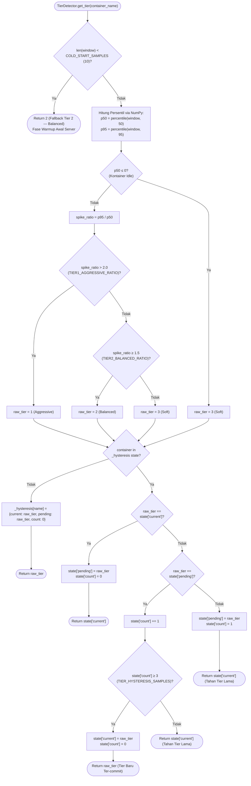
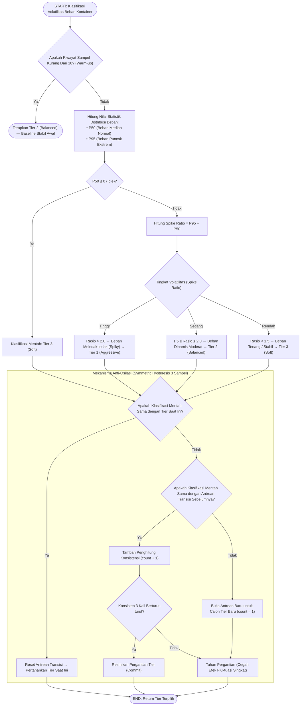

# Flowchart — TierDetector.get_tier() (Layer 3B)

> **Kode Sumber:** `framework/tier_detector.py` → class `TierDetector`, fungsi `add_sample()`, `get_tier()`, dan `get_stats()` (baris 25–125)
> **Posisi di Diagram:** Layer 3 — Hybrid Control Engine → 3B Analytic Tier Detection Engine (P95/P50)
> **Kategori:** 🌟 INOVASI ALGORITMA (S2)

Algoritma **Single-Window Volatility Classification** menggunakan rasio persentil beban kerja `spike_ratio = P95 / P50` pada satu jendela geser (`TIER_WINDOW = 120` sampel) per kontainer. Dilengkapi:
1. **Cold-Start Fallback:** Memaksa Tier 2 (Balanced) selama akumulasi sampel kurang dari `COLD_START_SAMPLES = 10` (5 menit pemanasan).
2. **Robust Spike Ratio:** Menggunakan P95/P50 untuk memisahkan beban *spiky* (Tier 1: > 2.0), *moderate* (Tier 2: 1.5 – 2.0), dan *smooth/idle* (Tier 3: < 1.5).
3. **Symmetric Hysteresis (3 Sampel):** Mencegah osilasi transisi tier dengan mewajibkan 3 sampel berturut-turut (`TIER_HYSTERESIS_SAMPLES = 3`) untuk perubahan tier naik maupun turun.

---

## Alur Logika Konseptual

