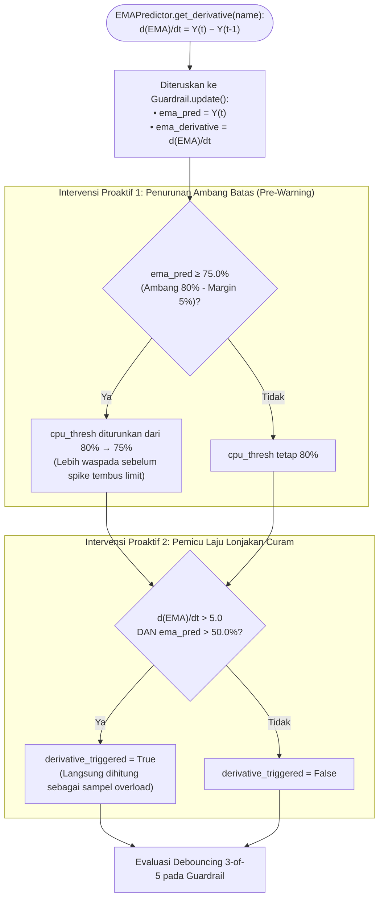
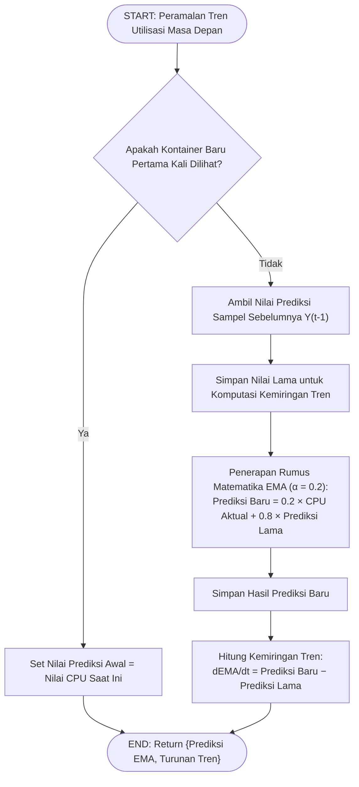

# Flowchart — EMAPredictor.update() (Layer 3C)

> **Kode Sumber:** `framework/predictor.py` → class `EMAPredictor`, fungsi `update()` dan `get_derivative()` (baris 12–66)
> **Posisi di Diagram:** Layer 3 — Hybrid Control Engine → 3C Proactive Prediction Engine (Fixed-Alpha EMA)
> **Kategori:** 🌟 INOVASI ALGORITMA (S2)

Algoritma **Lightweight Proactive Time-Series Forecasting** menggunakan Exponential Moving Average dengan **konstanta pemulus tetap $\alpha = 0.2$** (`EMA_ALPHA = 0.2`). Memenuhi batasan ketat tesis:
- Kompleksitas waktu $O(1)$ dan memori $O(1)$ per kontainer.
- Bebas dari pustaka machine learning berat (Scikit-Learn, PyTorch, TensorFlow).
- Menyediakan sinyal turunan pertama tren beban kerja:
  $$\frac{d(\text{EMA})}{dt} = \text{EMA}(t) - \text{EMA}(t-1)$$
  yang diintegrasikan langsung ke Layer 3A (Guardrail) untuk pencegahan lonjakan secara proaktif.

```mermaid
flowchart TD
    START(["EMAPredictor.update(container_name, cpu)"])

    CHECK_FIRST{"container_name in<br/>_predictions?"}
    INIT_FIRST["_predictions[name] = cpu<br/>Return round(cpu, 2)"]
    RETURN_INIT(["Return Nilai CPU Pertama"])

    STORE_PREV["y_prev = _predictions[name]<br/>_prev_ema[name] = y_prev"]

    CALC_EMA["Hitung Rumus Pemulusan Eksponensial:<br/>Y(t) = 0.2 × cpu + 0.8 × y_prev"]

    SAVE_NEW["_predictions[name] = Y(t)"]
    RETURN_PRED(["Return round(Y(t), 2)"])

    START --> CHECK_FIRST
    CHECK_FIRST -->|Tidak (Perdana)| INIT_FIRST
    INIT_FIRST --> RETURN_INIT
    CHECK_FIRST -->|Ya| STORE_PREV
    STORE_PREV --> CALC_EMA
    CALC_EMA --> SAVE_NEW
    SAVE_NEW --> RETURN_PRED
```

---

## Integrasi Sinyal EMA → Guardrail (Layer 3C ke Layer 3A)



---

## Alur Logika Konseptual


