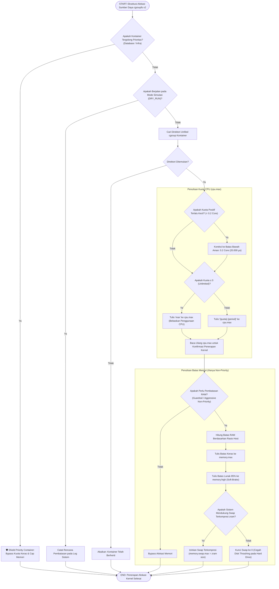

# Flowchart — shaper.shape_container() (Layer 4)

> **Kode Sumber:** `framework/shaper.py` → fungsi `shape_container()`, `_write_cpu()`, `_write_memory()`, `_write_swap_max()`, dan `reclaim_memory()` (baris 36–246)
> **Posisi di Diagram:** Layer 4 — Adaptive Resource Shaping → 4A Cgroups v2 Parameter Writer
> **Kategori:** 🛠️ TOOLS & INFRASTRUKTUR (S1)

Shaper bertindak sebagai subsistem eksekutif Linux cgroups v2. Menulis batas alokasi komputasi dan memori langsung ke kernel unified hierarchy tanpa me-restart kontainer.
- **Perlindungan Kontainer Prioritas (Shielding):** Kontainer bertanda `priority=True` (e.g. database / network infra) dilindungi dari pembatasan kuota keras CPU (`cpu_quota > 0`) dan pembatasan memori (`mem_ratio`).
- **Batas Bawah CPU (Minimum Floor):** Mencegah penalti starvation dengan batas bawah minimal 0.2 Core (`cpu_quota ≥ 20.000 µs`).
- **Read-Back Validation:** Verifikasi pembacaan ulang setelah menulis `cpu.max` untuk mendeteksi penolakan terselubung oleh scheduler kernel Linux (dengan 1× retry).
- **Pembatasan Memori Multi-Tingkat (Khusus Non-Priority pada Guardrail/Aggressive):**
  - `memory.max`: Batas keras alokasi RAM (`host_mem_bytes × mem_ratio`).
  - `memory.high`: Ambang soft-brake kernel pada 85% (`MEMORY_HIGH_RATIO = 0.85`) untuk memperlambat laju alokasi sebelum terkena OOM killer.
  - `memory.swap.max`: Penyesuaian swap berdasarkan ketersediaan swap terkompresi `zram`. Jika tidak ada zram, swap diset ke `0` untuk mencegah disk thrashing.
- **Proactive Memory Reclaim (`reclaim_memory`):** Menulis `0` ke `memory.reclaim` (kernel Linux ≥ 6.1) saat kontainer dibekukan/idle.

```mermaid
flowchart TD
    START(["shape_container(name, id, priority, cpu_quota,<br/>cpu_period, dry_run, mem_ratio, host_mem_bytes)"])

    CHECK_PRIO{"priority == True<br/>DAN cpu_quota &gt; 0?"}
    SKIP_SHIELD(["Log [SHIELD]: Kontainer Prioritas<br/>Bypass pembatasan keras<br/>Return True"])

    CHECK_DRY{"dry_run == True?"}
    LOG_DRY(["Log [DRY-RUN] Simulasi pembatasan<br/>Return True"])

    RESOLVE_PATH["Resolusi Path cgroup v2 Kontainer"]
    PATH_EXISTS{"Path Ditemukan?"}
    ABORT_PATH(["Log warning: cgroup path tidak ditemukan<br/>Return False"])

    subgraph CPU_SHAPING["Modulasi CPU (cpu.max)"]
        CHECK_MIN_FLOOR{"0 &lt; cpu_quota &lt;<br/>period × 0.2 (20.000 µs)?"}
        CLAMP_FLOOR["cpu_quota = 20.000 µs<br/>(Batas Bawah Aman 0.2 Core)"]

        CHECK_UNLIMITED{"cpu_quota ≤ 0?"}
        WRITE_MAX["expected = 'max'<br/>Tulis 'max' ke cpu.max (Lepas Limit)"]
        WRITE_QUOTA["expected = '{quota} {period}'<br/>Tulis ke cpu.max (Batas Diterapkan)"]

        VALIDATE_READ["_validate_write():<br/>Baca ulang file cpu.max"]
        VAL_MATCH{"Isi file sesuai<br/>nilai yang ditulis?"}
        RETRY_CPU["Log warning: Retry tulis cpu.max 1 kali"]
        CPU_SUCCESS["CPU Shaping OK"]
    end

    subgraph MEM_SHAPING["Modulasi Memori (Non-Priority Saja)"]
        CHECK_MEM_COND{"mem_ratio di-set<br/>DAN priority == False<br/>DAN host_mem_bytes &gt; 0?"}
        MEM_BYPASS["Bypass Modulasi RAM<br/>(Kontainer normal/prioritas)"]

        CALC_MEM_BYTES["mem_bytes = int(host_mem_bytes × mem_ratio)"]
        WRITE_MEM_MAX["1. Tulis mem_bytes ke memory.max (Hard Limit)"]

        CALC_MEM_HIGH["mem_high_bytes = int(mem_bytes × 0.85)"]
        WRITE_MEM_HIGH["2. Tulis mem_high_bytes ke memory.high<br/>(Kernel Soft-Brake)"]

        CHECK_ZRAM["3. Periksa ketersediaan zram di /sys/block/zram*/disksize"]
        ZRAM_ACTIVE{"zram_size &gt; 0?"}
        SET_SWAP_ZRAM["swap_limit = min(mem_bytes, zram_size)<br/>Tulis swap_limit ke memory.swap.max"]
        SET_SWAP_ZERO["swap_limit = 0 (Cegah Disk Thrashing)<br/>Tulis '0' ke memory.swap.max"]
    end

    RETURN_STATUS(["Return (cpu_ok and mem_ok)"])

    START --> CHECK_PRIO
    CHECK_PRIO -->|Ya| SKIP_SHIELD
    CHECK_PRIO -->|Tidak| CHECK_DRY

    CHECK_DRY -->|Ya| LOG_DRY
    CHECK_DRY -->|Tidak| RESOLVE_PATH

    RESOLVE_PATH --> PATH_EXISTS
    PATH_EXISTS -->|Tidak| ABORT_PATH
    PATH_EXISTS -->|Ya| CHECK_MIN_FLOOR

    CHECK_MIN_FLOOR -->|Ya| CLAMP_FLOOR
    CHECK_MIN_FLOOR -->|Tidak| CHECK_UNLIMITED
    CLAMP_FLOOR --> CHECK_UNLIMITED

    CHECK_UNLIMITED -->|Ya| WRITE_MAX
    CHECK_UNLIMITED -->|Tidak| WRITE_QUOTA

    WRITE_MAX --> VALIDATE_READ
    WRITE_QUOTA --> VALIDATE_READ

    VALIDATE_READ --> VAL_MATCH
    VAL_MATCH -->|Tidak| RETRY_CPU
    RETRY_CPU --> CPU_SUCCESS
    VAL_MATCH -->|Ya| CPU_SUCCESS

    CPU_SUCCESS --> CHECK_MEM_COND
    CHECK_MEM_COND -->|Tidak| MEM_BYPASS
    CHECK_MEM_COND -->|Ya| CALC_MEM_BYTES

    CALC_MEM_BYTES --> WRITE_MEM_MAX
    WRITE_MEM_MAX --> CALC_MEM_HIGH
    CALC_MEM_HIGH --> WRITE_MEM_HIGH
    WRITE_MEM_HIGH --> CHECK_ZRAM

    CHECK_ZRAM --> ZRAM_ACTIVE
    ZRAM_ACTIVE -->|Ya| SET_SWAP_ZRAM
    ZRAM_ACTIVE -->|Tidak| SET_SWAP_ZERO

    MEM_BYPASS --> RETURN_STATUS
    SET_SWAP_ZRAM --> RETURN_STATUS
    SET_SWAP_ZERO --> RETURN_STATUS
```

---

## Alur Logika Konseptual

