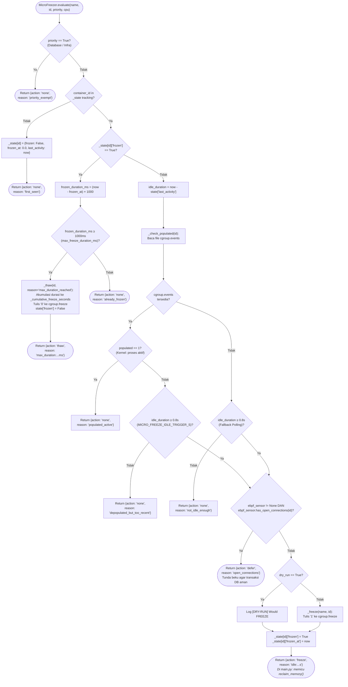
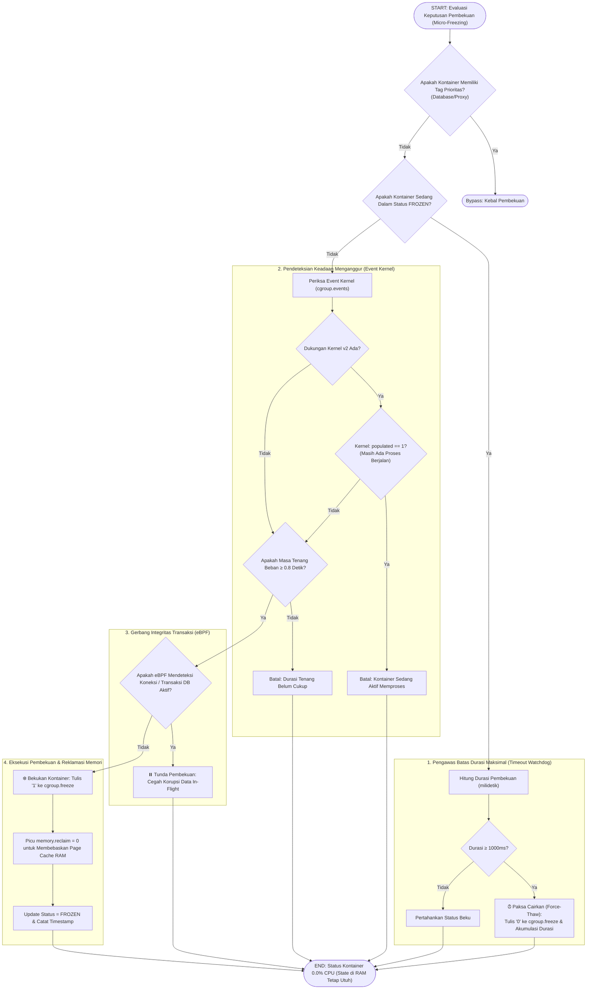

# Flowchart — MicroFreezer.evaluate() (Layer 4)

> **Kode Sumber:** `framework/security/micro_freezer.py` → class `MicroFreezer`, fungsi `evaluate()`, `record_activity()`, `_freeze()`, dan `_thaw()` (baris 37–274)
> **Posisi di Diagram:** Layer 4 — Adaptive Resource Shaping → 4B Sub-second Micro-Freezing & Zero-CPU Idle Engine
> **Kategori:** 🌟 INOVASI ALGORITMA (S2)

Algoritma pembekuan kontainer berbasis kernel Linux cgroups v2 (`cgroup.freeze`). Mengurangi utilisasi CPU kontainer yang menganggur ke **persis 0.0% CPU** tanpa terminasi proses atau degradasi *cold-start delay*.
- **Pendeteksian Idle Hybrid:** Mengutamakan sinyal event kernel Linux unified hierarchy (`cgroup.events` kolom `populated == 0`) dipadukan dengan jeda tenang minimum `MICRO_FREEZE_IDLE_TRIGGER_S = 0.8s`.
- **Safety Gate (eBPF / Netlink Transaksi):** Memeriksa apakah ada transaksi database atau koneksi aktif yang belum terselesaikan (`ebpf_sensor.has_open_connections()`) sebelum pembekuan dieksekusi.
- **Batas Siklus Beku Maksimal (Hard Timeout):** Maksimal durasi beku dibatasi `MICRO_FREEZE_MAX_DURATION_MS = 1000ms`. Bila terlewati, mekanisme *Force-Thaw* langsung diaktifkan untuk menjaga SLA jaringan.
- **Pencairan Sub-Milidetik:** Menulis `cgroup.freeze = 0` mencairkan kontainer dalam waktu <1ms saat request baru tiba (`record_activity`).
- **Active Memory Reclaim (`memory.reclaim`):** Pada `main.py`, pembekuan kontainer langsung memicu pembersihan cache halaman RAM tak terpakai.
- **Akumulasi Telemetri:** Durasi beku diakumulasikan (`get_cumulative_freeze_seconds`) dan dicatat ke kolom ke-16 `metrics.csv`.

---

## Alur Logika Konseptual

