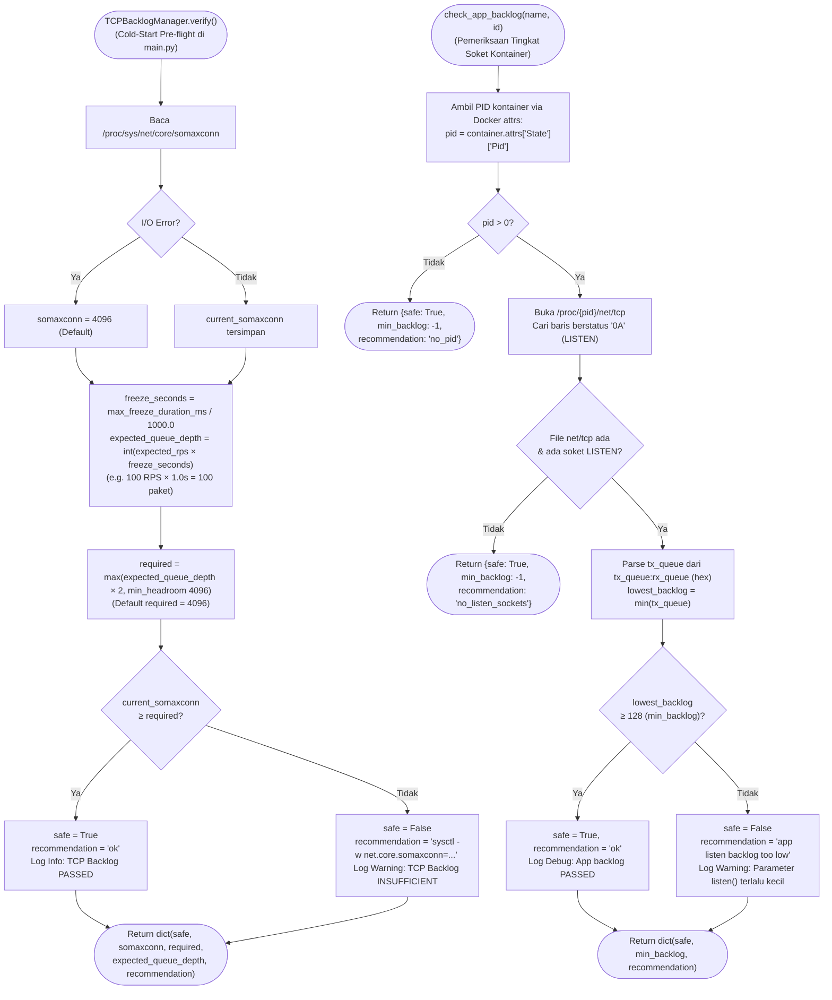
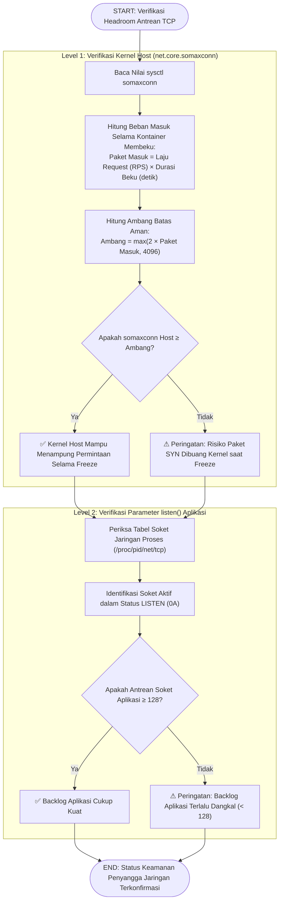

# Flowchart — TCPBacklogManager (Layer 4)

> **Kode Sumber:** `framework/security/tcp_backlog_manager.py` → class `TCPBacklogManager`, fungsi `verify()` dan `check_app_backlog()` (baris 24–194)
> **Posisi di Diagram:** Layer 4 — Adaptive Resource Shaping → 4B Network-Buffer Headroom Pre-flight Verifier
> **Kategori:** 🌟 INOVASI ALGORITMA (S2)

Mekanisme verifikasi kapasitas antrean jaringan kernel (*Network-Buffer-Aware Verification*) yang menjadi prasyarat keamanan operasi Micro-Freezing. Memastikan bahwa saat kontainer non-priority dibekukan (500–1000ms), paket permintaan HTTP/TCP baru yang masuk tidak di-drop oleh kernel melainkan ditampung di antrean buffer soket host sampai kontainer dicairkan (<1ms).
- **Tingkat 1 — Pre-Flight Kernel Host (`verify`):** Berjalan saat cold start `_init_security()` di `main.py`. Membaca `/proc/sys/net/core/somaxconn`. Menghitung kedalaman antrean ekspektasi $Q = \text{RPS} \times t_{\text{freeze}}$ dan membandingkannya terhadap ambang batas minimal $\max(2Q, 4096)$.
- **Tingkat 2 — Pemeriksaan Soket Aplikasi (`check_app_backlog`):** Membaca `/proc/<pid>/net/tcp` proses kontainer untuk memastikan soket server dengan status `LISTEN` (kode hex `0A`) memiliki backlog `listen(fd, backlog)` minimal $\ge 128$.

---

## Alur Logika Konseptual

