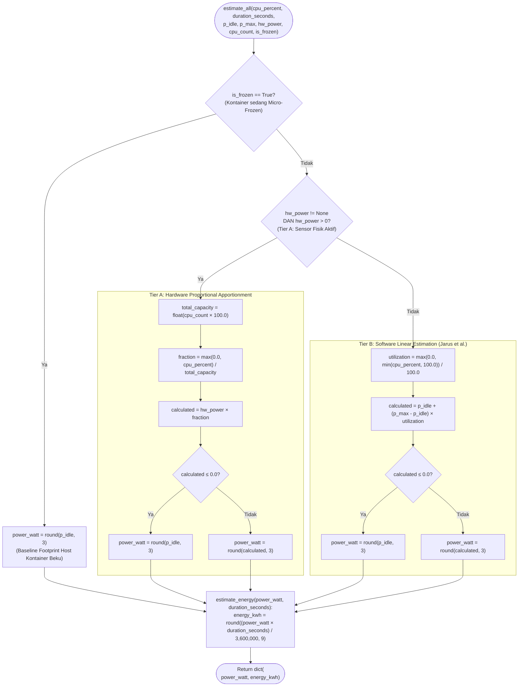
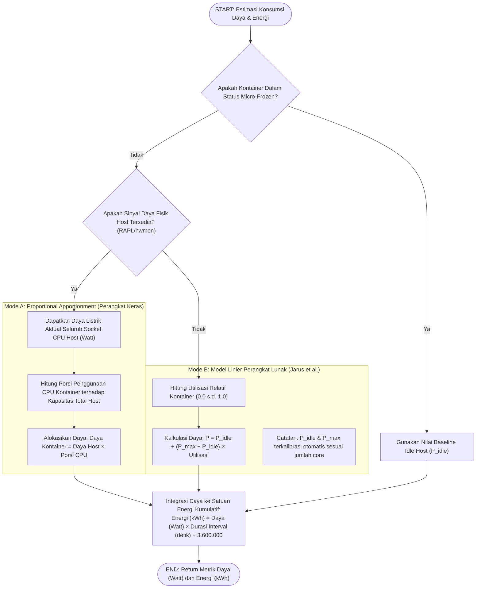

# Flowchart — energy.estimate_all() (Supplementary)

> **Kode Sumber:** `framework/energy.py` → fungsi `estimate_power()`, `estimate_energy()`, dan `estimate_all()` (baris 7–59)
> **Posisi di Diagram:** Supplementary Services → Estimator Konsumsi Daya (Hybrid Hardware/Software Model)
> **Kategori:** 🌟 INOVASI ALGORITMA (S2)

Model estimasi konsumsi energi hibrida (Joule dan kWh, tanpa konversi emisi karbon sesuai batasan penelitian proposal). Mendukung dua tingkat resolusi:
1. **Tier A — Hardware-True Mode (Motherboard Physical Sensors):** Bila sensor perangkat keras (Intel RAPL / AMD hwmon) terdeteksi, daya listrik aktual paket CPU ($P_{\text{total}}$ dalam Watt) dialokasikan secara proporsional ke tiap kontainer berdasarkan fraksi beban komputasinya:
   $$P_{\text{container}} = P_{\text{hw\_total}} \times \left( \frac{\text{CPU}_{\text{container}}\%}{\text{Host Cores} \times 100\%} \right)$$
2. **Tier B — Software Estimation Mode (Cloud VPS / Hypervisor):** Menggunakan model linier terkalibrasi dinamis Jarus et al. (2014, margin error <4%):
   $$P(t) = P_{\text{idle}} + (P_{\text{max}} - P_{\text{idle}}) \times U_{\text{CPU}}(t)$$
   dengan $P_{\text{idle}} = \text{cores} \times 3.75\text{W}$ dan $P_{\text{max}} = \text{cores} \times 13.5\text{W}$.
3. **Penanganan Status Micro-Frozen (`is_frozen=True`):** Mengembalikan baseline daya idle host ($P_{\text{idle}}$) sebagai footprint dasar kontainer, menjaga konsistensi dataset telemetri tanpa nilai nol anomali.
4. **Integrasi Energi (kWh):** Dihitung per interval waktu:
   $$E_{\text{kWh}} = \frac{P_{\text{watt}} \times \Delta t_{\text{seconds}}}{3.600.000}$$

---

## Alur Logika Konseptual

