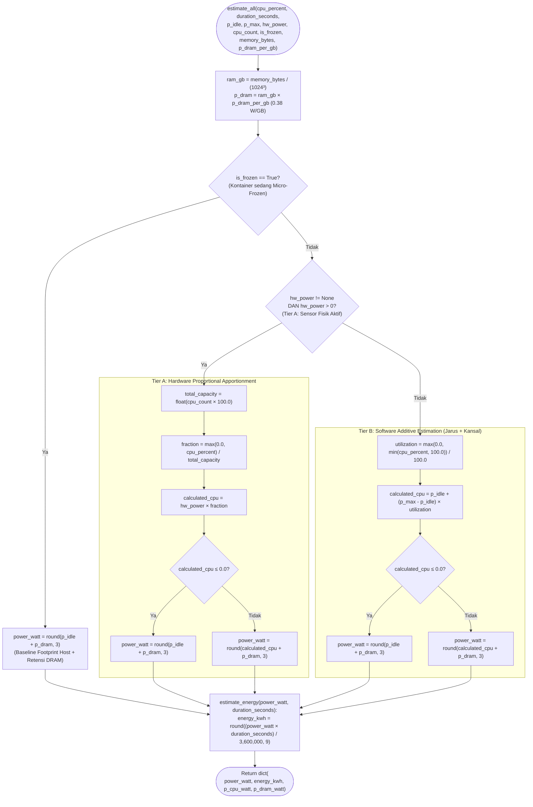
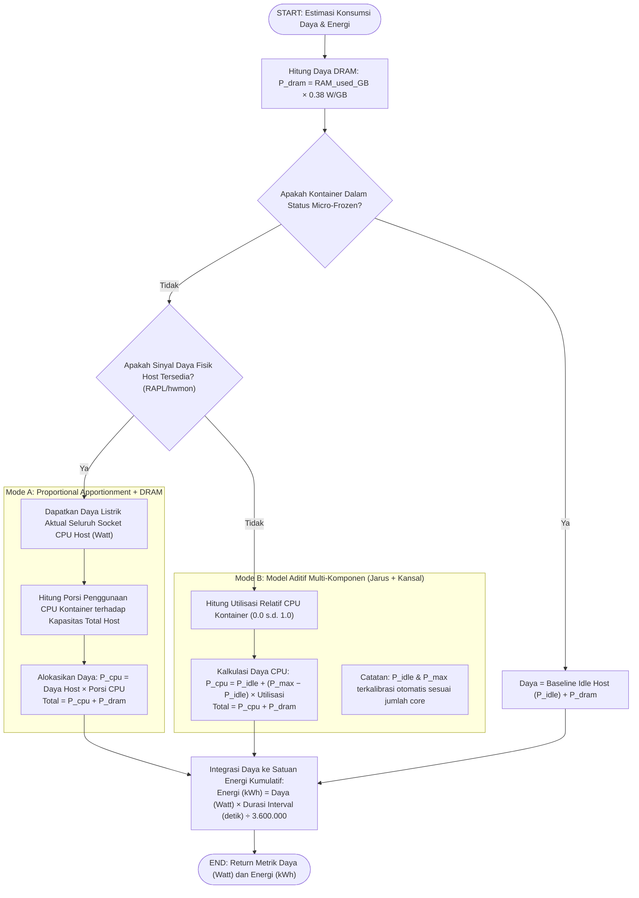

# Flowchart — energy.estimate_all() (Supplementary)

> **Kode Sumber:** `framework/energy.py` → fungsi `estimate_power()`, `estimate_energy()`, dan `estimate_all()` (baris 7–75)
> **Posisi di Diagram:** Supplementary Services → Estimator Konsumsi Daya (Hybrid Hardware/Software Model + Additive DRAM)
> **Kategori:** 🌟 INOVASI ALGORITMA (S2)

Model estimasi konsumsi energi hibrida (Joule dan kWh, tanpa konversi emisi karbon sesuai batasan penelitian proposal). Menggunakan **Additive Multi-Component Model** ($P_{\text{total}} = P_{\text{cpu}} + P_{\text{dram}}$) yang menggabungkan Jarus et al. (2014) untuk CPU dan Kansal et al. (Joulemeter) / CNCF Kepler ($C_{\text{dram}} = 0.38\text{ W/GB}$) untuk memori:

1. **Komponen DRAM ($P_{\text{dram}}$):** Dihitung dari working set memory kontainer (`memory.current - inactive_file`):
   $$P_{\text{dram}}(t) = \text{RAM}_{\text{used\_GB}}(t) \times C_{\text{dram}}$$
2. **Tier A — Hardware-True Mode (Motherboard Physical Sensors):** Bila sensor perangkat keras (Intel RAPL / AMD hwmon) terdeteksi, alokasi CPU proporsional ditambahkan ke footprint DRAM:
   $$P_{\text{container}}(t) = \left[ P_{\text{hw\_total}} \times \left( \frac{\text{CPU}_{\text{container}}\%}{\text{Host Cores} \times 100\%} \right) \right] + P_{\text{dram}}(t)$$
3. **Tier B — Software Estimation Mode (Cloud VPS / Hypervisor):** Menggunakan model linier terkalibrasi dinamis untuk CPU ditambah footprint DRAM:
   $$P_{\text{total}}(t) = \left[ P_{\text{idle}} + (P_{\text{max}} - P_{\text{idle}}) \times U_{\text{CPU}}(t) \right] + P_{\text{dram}}(t)$$
   dengan $P_{\text{idle}} = \text{cores} \times 3.75\text{W}$ dan $P_{\text{max}} = \text{cores} \times 13.5\text{W}$.
4. **Penanganan Status Micro-Frozen (`is_frozen=True`):** Mengembalikan baseline daya idle host ($P_{\text{idle}}$) ditambah daya retensi DRAM aktif ($P_{\text{dram}}$) sebagai footprint dasar kontainer, menjaga konsistensi dataset telemetri tanpa nilai nol anomali.
5. **Integrasi Energi (kWh):** Dihitung per interval waktu:
   $$E_{\text{kWh}} = \frac{P_{\text{watt}} \times \Delta t_{\text{seconds}}}{3.600.000}$$

---

## Alur Logika Konseptual

